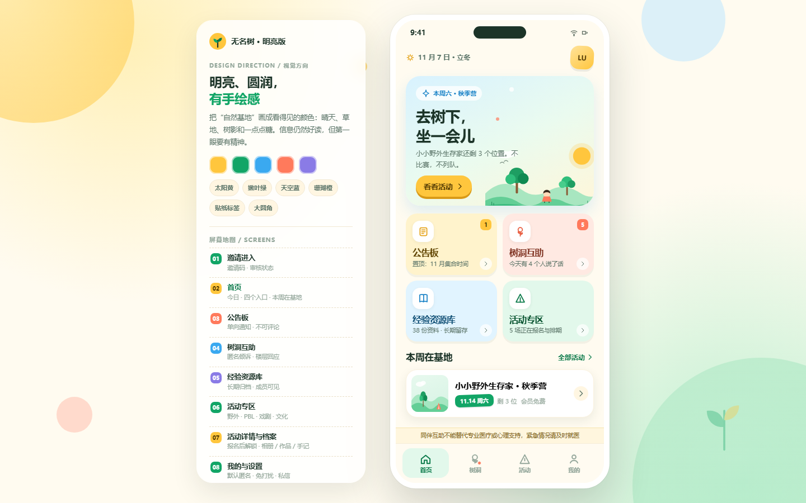

# 无名树 · 家长社群 App 产品原型

「无名树」是一个只对邀请开放的家长陪伴社群，服务处在休整期（休学、居家、拒学）的孩子与家庭；同时运营自然教育、PBL、戏剧等长线活动。这份原型演示这类社群真正需要的 App 应该长什么样。

## 在线预览

https://zhumin2.github.io/wumingtree-app/

## 这是什么

一份**单文件 HTML 可交互原型**（`index.html`），不依赖构建工具、外链字体或任何外部资源，双击即可在浏览器打开。

桌面浏览器里是「设计说明 + 392px 手机壳」的展示形态；窗口宽度小于 480px 时自动切换为全屏手机视图。

## 这一版的视觉

上一版是米白 + 墨绿的克制素净风，这一版按「活泼、有生气」重做：

- 奶油白底 `#FFFBF0`，主色嫩叶绿 `#12A566`
- 太阳黄、珊瑚橙、天空蓝、葡萄紫四色分区：公告、树洞、资源、活动各自有颜色
- 大圆角、按钮厚底投影、轻微旋转的贴纸标签
- 首页迷你场景卡与漂浮动画，活动封面全部用内联 SVG 手绘（太阳、云、山丘、树、帐篷、小人）

## 演示路径

1. **邀请进入**：邀请码 → 提交申请 → 管理员审核 → 通过（左侧说明卡「01」可进入）
2. **首页**：今日一句、四个入口、本周在基地、常驻风险提示
3. **公告板**：单向通知、置顶、不可评论
4. **树洞互助**：默认匿名，心情筛选、楼层回应、抱一下 / 我也是、举报
5. **经验资源库**：按主题归档，部分文件夹仅活动成员可见
6. **活动专区**：五场活动、类型筛选、名额状态、报名与报名成功
7. **活动详情与档案**：详情 / 讨论区 / 活动档案；未报名时档案锁定，报名后解锁相册、孩子作品、老师手记
8. **我的**：我的报名、我的树洞、孩子的作品、私信、设置

## 产品红线

- 没有公开广场与算法推荐
- 没有积分、勋章、排行榜、打卡
- 不做晒娃 feed，不接商业广告
- 公告板只读，不开放评论
- 树洞默认匿名，红点不显示数字
- 活动档案报名后才可见；相册只显示集体合照与自己孩子
- 老师手记不打分、不评级
- 首页风险提示常驻：同伴互助不能替代专业医疗或心理支持

## 演示边界

原型里的数据全部是虚构示例，刷新后复位。资源库检索与文件预览只用提示语兜底，没有真实功能；报名、审核都是前端模拟。

## 产品文档与接手说明

- [产品说明文档](docs/无名树App产品说明文档-v1.0.docx)：定位、用户、产品原则、信息架构、核心功能、关键流程、数据模型、视觉规范、原型边界与开放问题。
- [Agent 接手说明](agents.md)：当前状态、已知演示态、代码结构、构建检查、GitHub 发布方式与下一步建议。
