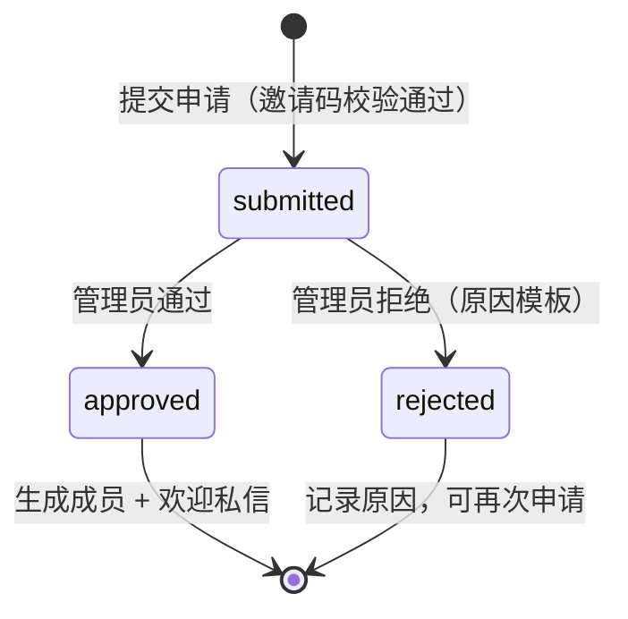
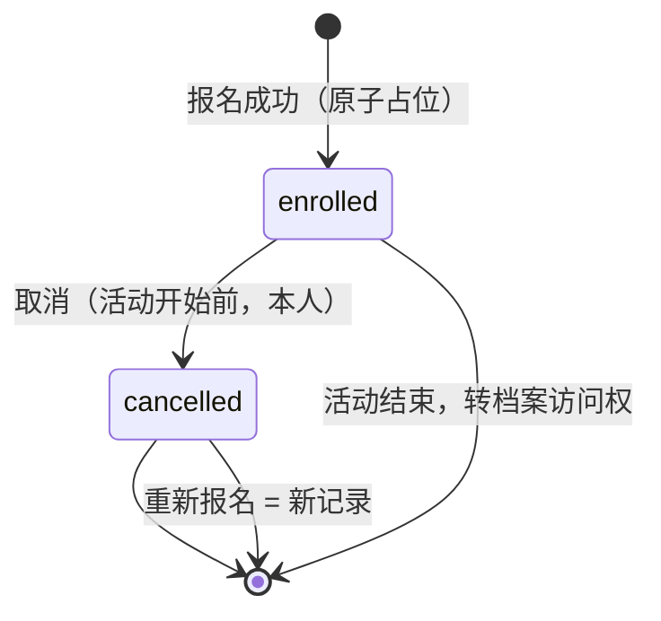
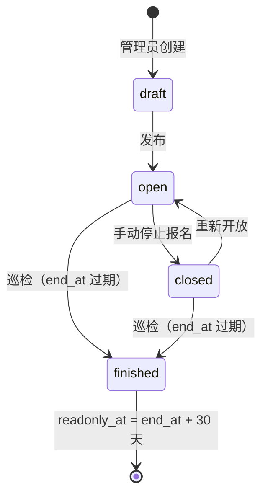
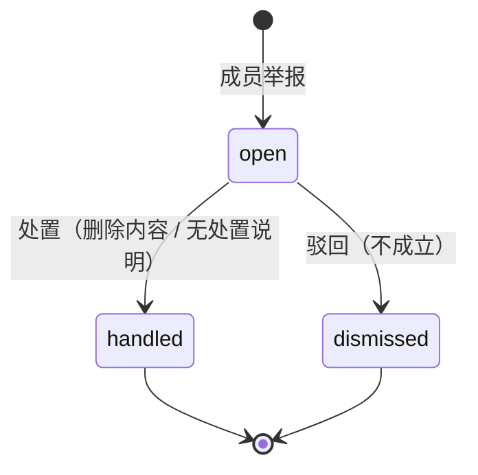
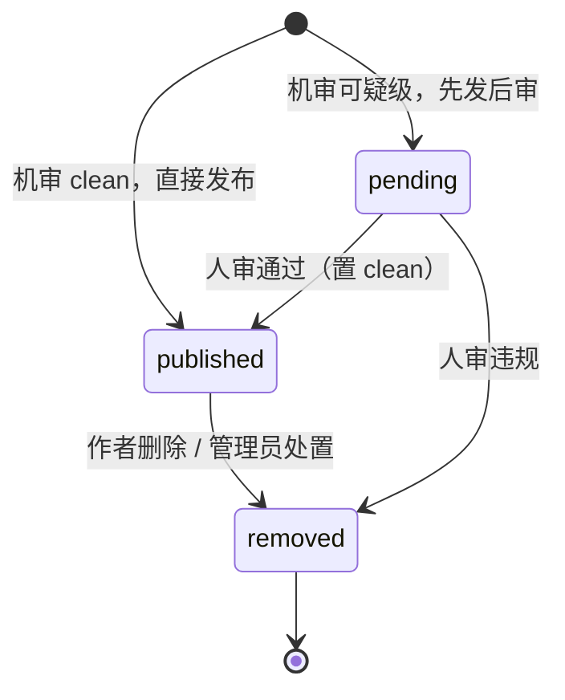

# 无名树 App · 细化设计 v1.0

| 项目 | 内容 |
|---|---|
| 版本 | V1.0 |
| 日期 | 2026 年 11 月 7 日 |
| 配套 | 《无名树App技术设计文档-v1.0》（下称主文档） |
| 状态 | 工程种子稿，随主文档评审 |

主文档定架构与方案；本文与同目录两个种子文件负责「可直接开工」：

| 文件 | 内容 | 用法 |
|---|---|---|
| 本文 | 状态机、错误码、字段校验、API 示例、限流、定时任务、机审降级、免打扰细节 | 评审基线 |
| `schema-init-v1.0.sql` | 19 张表全量 MySQL DDL | golang-migrate up 迁移，迁入 server 仓库 `migrations/` |
| `openapi-v1.0.yaml` | API 契约初稿（核心端点） | oapi-codegen 输入；同时产出 Dart 客户端 |

---

## 1 相对主文档的增补（评审后回写主文档）

| # | 增补 | 位置 | 说明 |
|---|---|---|---|
| 1 | `review_status` 字段 | post / floor / activity_comment / message | `clean` / `pending`，承载机审「可疑级先发后审」；拒绝级不入库，见第 7 节 |
| 2 | 表数量修正 | 主文档 1.3 | 实为 19 张（notice_read 为独立表），DDL 以本目录 SQL 为准 |
| 3 | 限流与锁定策略 | 主文档 5.1 | 见本文第 6 节 |
| 4 | 机审降级策略 | 主文档 6.1 | 见本文第 7 节 |
| 5 | 免打扰「延迟投递」细节 | 主文档 7.2 | 见本文第 9 节 |
| 6 | 定时任务清单 | 主文档 4.6 | 见本文第 8 节，含幂等与补偿 |
| 7 | 手机号独立表 `member_secure`；验证码改存 Redis TTL（删 sms_verify 表）；`oss_key` 更名 `file_key` | DDL | 对齐架构设计 3.3 / 3.9；主文档 5.3 已同步 |
| 8 | 统一响应信封与数字错误码 | 全部接口 | 对齐架构设计 3.2；主文档 4.4 已同步，见本文第 3 节 |
| 9 | 幂等改用 `client_token` 字段且**先于频控**执行 | 写操作 | 对齐架构设计 3.4 铁律；主文档 4.4 已同步 |

---

## 2 状态机

### 2.1 加入申请 application



| 转移 | 前置条件 | 副作用 |
|---|---|---|
| 提交 → submitted | 邀请码 active、次数未满、在有效期；同 phone_hash 无未结申请且无 active 成员 | 事务内邀请码 `used_count+1`；申请入库 |
| submitted → approved | 管理员操作 | 事务内创建 member（沿用申请的称呼与手机号密文）、申请关联 member_id；发欢迎私信；推送申请者 |
| submitted → rejected | 管理员操作，原因从模板选择 | 推送申请者（含原因）；不占用邀请码次数返还（已消耗不返还） |
| 超时提醒 | submitted 超过 48 小时 | 每日任务提醒管理员，不自动拒绝 |

再申请规则：rejected 后可提交新申请；提交前校验同 `phone_hash` 不存在 submitted 状态申请、不存在 active 成员。

### 2.2 报名 enrollment



| 规则 | 说明 |
|---|---|
| 取消窗口 | 活动开始前本人可取消；开始后不可自行取消，引导私信管理员（管理台人工处理并记录） |
| 副作用 | 名额 -1；通知带队老师；档案权按主文档 4.5 规则收回 |
| 重新报名 | 新记录；受生成列 `active_key` 唯一约束（仅 enrolled 防重） |
| 并发 | 条件 UPDATE 占位，见主文档 4.5 时序 |

### 2.3 活动 activity



| 规则 | 说明 |
|---|---|
| 容量满不自动 closed | 有人取消可回流名额；报名按钮按「剩余名额 + 我的报名态」实时禁用，与卡片三态一致 |
| finished | 每小时巡检任务置位，同一事务写 `readonly_at` |
| 状态与按钮映射 | open 且 remaining>0 且未报名 → 剩余 N 位；remaining=0 且未报名 → 名额已满；my_enrolled → 已报名；其余 → 按钮禁用 |

### 2.4 举报 report



| 规则 | 说明 |
|---|---|
| SLA | 首次处理中位数目标 24 小时；pending 超时任务每小时提醒 |
| 处置联动 | 「删除内容」= 目标 `status=removed`（removed_reason='by_report'）；「无处置」必须填说明 |
| 不通知作者 | 处置不主动通知被举报内容作者（匿名环境避免压力），仅管理台留痕；处置前后对作者不可见举报信息（红线） |
| 举报人 | reporter_id 任何接口不回传（红线） |

### 2.5 内容（帖子 / 楼层 / 讨论区 / 私信）



| 规则 | 说明 |
|---|---|
| 拒绝级 | 不入库，同步返回 `422 CONTENT_REJECTED`（文案提示修改，不透露规则细节） |
| pending 可见性 | 正常可见（先发后审），人审违规后移除 |
| 删帖 | 作者删帖置 removed（reason='by_author'），楼层随帖子整体不可见；removed 不可恢复（申诉放第二阶段） |

### 2.6 档案

| 状态 | 说明 |
|---|---|
| writable | 活动结束后老师 / 管理员可上传，报名成员可查看 |
| readonly | `readonly_at` 到达后：查看与签名 URL 正常；上传关闭；客户端显示「已归档 · 只读」标识 |

### 2.7 会话令牌

| 规则 | 说明 |
|---|---|
| Access Token | 7 天；客户端收到 2001 时静默刷新重放一次 |
| Refresh Token | 30 天，轮换：每次刷新发新对，旧 refresh 作废 |
| 复用检测 | 已作废的 refresh 再次使用 = 可能泄露，吊销该成员全部会话并要求重新登录（`401 TOKEN_REUSE`） |

---

## 3 错误码表（统一信封 · 数字码）

所有接口 HTTP 恒为 200（网络 / 网关层错误除外），业务结果看信封 code（架构设计 3.2）：

```json
{ "code": 0, "message": "ok", "data": { }, "request_id": "uuid" }
```

| code | 场景 | 客户端处理 |
|---|---|---|
| 0 | 成功 | 解包 data |
| 1001 | 参数或校验失败 | `data.errors[{field,reason}]` 逐字段提示 |
| 2001 | 未登录 / Token 过期 | 静默刷新后重放 |
| 2002 | 刷新令牌复用，会话已吊销 | 清空会话回登录页 |
| 3001 | 验证码错误或过期 | 表单错误提示 |
| 3002 | 邀请码无效 / 过期 / 次数用尽 | 表单错误提示 |
| 4001 | 操作过于频繁 | 提示稍后再试（不带惩罚语气） |
| 4101 | 内容审核未通过 | 提示修改，不透出规则 |
| 4201 | 名额已满 | 提示后刷新名额状态 |
| 4202 | 重复报名同一孩子 | 提示已在名单 |
| 4203 | 手机号已有成员或未结申请 | 引导直接登录 |
| 4204 | 缺少必要同意 | 定位到未勾选项 |
| 5001 | 目标不存在或已删除（越权、未报名访问档案统一映射到此，不泄露存在性） | 空态 / 返回；档案场景渲染深链接兜底页 |
| 5002 | 无权限（成员资料锁定 / 家长间私信 / 非作者删帖） | 锁定引导页；私信场景提示「家长之间想聊天，请去树洞」 |
| 9000 | 服务内部错误 | Toast + request_id 反馈 |
| 9001 | 机审 / 短信依赖不可用 | 按降级策略（第 7 节），提示稍后重试 |

哨兵错误与 code 的映射集中在服务端 `pkg/code`，module 层用 `errors.Is/As` 统一转换，业务代码不散落数字。

---

## 4 字段校验规则

| 字段 | 规则 |
|---|---|
| 邀请码 | 展示格式 `WMT-XXXX-XXXX`；提交时去连字符后校验 12 位大写字母数字 |
| 称呼 / 昵称 | 1–8 字（产品规则），去首尾空格 |
| 手机号 | 中国大陆 11 位，`1[3-9]` 开头（保守口径，待确认是否放宽） |
| 帖子标题 | 1–50 字，必填 |
| 帖子正文 | 0–2000 字，可选 |
| 楼层 | 1–500 字 |
| 讨论区发言 | 1–300 字 |
| 私信 | 1–500 字 |
| 孩子称呼 | 1–20 字 |
| 孩子年龄 | 2–18 整数 |
| 报名备注 | 0–200 字，选填 |
| 举报说明 | 0–200 字（reason=other 建议填写） |
| 心情 / 活动类型 / 举报原因 | 枚举校验（share/tired/ask/talk；outdoor/pbl/drama/culture/salon；privacy/attack/ads/other） |
| 报名同意 | consents 必须同时含 `safety` 与 `photo` 的当前生效版本 |

---

## 5 核心 API 示例（红线在 DTO 层的体现）

> 以下示例展示**信封内 `data` 的结构**；实际响应统一为 `{"code":0,"message":"ok","data":…,"request_id":"…"}`（架构设计 3.2）。

### 5.1 树洞列表：匿名帖响应无作者字段

```json
// GET /api/v1/posts?mood=tired&cursor=
{
  "items": [
    {
      "id": 102,
      "mood": "tired",
      "title": "开学第三周，我还是没敢跟老师说",
      "body": "每天早上照常出门，绕到河边坐两小时。……",
      "isAnonymous": true,
      "displayName": "一位家长",
      "replies": 12,
      "reactions": { "hug": 31, "meToo": 18 },
      "myReactions": ["hug"],
      "publishedAt": "2026-10-26T09:12:00+08:00"
    }
  ],
  "nextCursor": "MTAyfDE3NjE0NDYzMjAwMA"
}
```

要点：匿名帖响应体没有 `authorId` / `nickname` 字段（结构级红线，见主文档 2.4）；`replies` 是回应计数，与未读无关；固定时间倒序，无排序参数。

### 5.2 红点：只有布尔

```json
// GET /api/v1/me/badges
{ "notice": true, "hollow": false, "dm": true }
```

### 5.3 报名：同意版本化 + 幂等

```json
// POST /api/v1/activities/11/enrollments
// Header: client_token: 7b9e3a4c-...（幂等键，重试时复用；先于频控检查）
{
  "childName": "小满",
  "childAge": 10,
  "note": "孩子第一次参加，人多容易紧张",
  "consents": ["safety@v1", "photo@v1"]
}

// 201
{
  "id": 3001,
  "status": "enrolled",
  "ticket": {
    "activityTitle": "小小野外生存家 · 秋季营",
    "gatherTime": "11.14 周六 08:00",
    "gatherPlace": "无名树基地 · 东门",
    "childName": "小满",
    "teacherName": "林老师"
  },
  "maskedPhone": "138****1234"
}
```

### 5.4 档案：audience 过滤后的条目

```json
// GET /api/v1/activities/11/archive
{
  "counts": { "photos": 6, "works": 3, "notes": 2 },
  "readonly": false,
  "photos": [
    {
      "id": 81,
      "title": "出发前 · 基地入口",
      "audience": "all",
      "thumbUrl": "/api/v1/files/81_w400.jpg?token=…（15 分钟短时效）",
      "previewUrl": "/api/v1/files/81_w1080.jpg?token=…（15 分钟短时效）"
    }
  ],
  "works":  [ { "id": 91, "title": "基地东侧动线草图", "childTag": "小满" } ],
  "notes":  [ { "id": 95, "teacherName": "林老师", "teacherRole": "营地带队", "dateLabel": "11.14", "content": "小满今天没有第一个冲出去……" } ]
}
```

要点：`audience=specific` 且未授权给当前成员的照片根本不出现在响应中（不是标记为锁定）；`previewUrl` 是预览规格而非原图，短时效签名（15 分钟）。

### 5.5 举报：无举报人回显

```json
// POST /api/v1/reports
{ "targetType": "floor", "targetId": 5521, "reason": "attack", "detail": "" }
// 201 → { "id": 9001 }
```

### 5.6 错误响应

```json
// 统一信封：HTTP 恒为 200，错误看 code
{ "code": 4201, "message": "名额已满", "data": null, "request_id": "req_01HYZ8…" }

{ "code": 1001, "message": "请检查填写内容", "request_id": "req_01HYZ9…",
  "data": { "errors": [ { "field": "consents", "reason": "需要勾选两条同意" } ] } }
```

---

## 6 限流与防刷

实现位置：`internal/platform/ratelimit`，Redis 计数器（滑动窗口）。

| 接口 | 限制 |
|---|---|
| 短信验证码 | 同号 60 秒 1 条、24 小时 5 条；同 IP 24 小时 20 条；超阈值触发图形验证码 |
| 提交申请 | 同 IP 10 次 / 小时；同 phone_hash 仅 1 条未结申请 |
| 登录 | 同号连续失败 5 次锁定 15 分钟 |
| 发帖 | 10 条 / 天 / 成员 |
| 楼层 / 讨论区 | 50 条 / 天 / 成员 |
| 私信 | 200 条 / 天 / 成员 |
| 举报 | 20 条 / 天 / 成员 |
| 文件签名 URL | 60 次 / 分钟 / 成员 |

限流触发出 `429 RATE_LIMITED`，文案不带惩罚语气（「过一会再试试」）。

---

## 7 机审与降级

正常流水线见主文档 6.1。依赖不可用时的降级：

| 场景 | 策略 |
|---|---|
| 文本机审 API 不可用 | 走本地兜底敏感词库（拒绝级词汇仍拦截，返回 CONTENT_REJECTED）；其余置 `review_status=pending` 进人工队列，发布不阻塞 |
| 图片机审不可用 | 图片先入库私有桶，`review_status=pending`；未过审前仅发布者可见，恢复后补审放行 |
| 短信服务不可用 | 登录返回 `503 DEPENDENCY_UNAVAILABLE`，提示稍后重试；不做任何绕过 |
| 恢复后 | 补审任务按队列顺序处理 pending 内容 |

---

## 8 定时任务清单

| 任务 | 频率 | 幂等保证 | 补偿 |
|---|---|---|---|
| 申请超时提醒 | 每日 09:00 | 去重键 `app_id+日期`，不重复提醒 | 漏跑次日补扫 |
| 活动状态巡检（finished + readonly_at） | 每小时 | 条件 UPDATE（仅 status 命中时生效） | 幂等，重跑无副作用 |
| 人工复核超时提醒 | 每小时 | 查 pending 超 24h，去重键 `target_id+日期` | 漏跑下轮补 |
| 未读标记对账 | 每日 04:00 | 以 DB 为准重建 Redis 位标记 | 全量重算，天然幂等 |
| 审计异常扫描 | 事件实时 | 阈值触发（如照片签名 100 次/小时） | 告警去重键 `actor+action+小时` |

执行器：单实例 Redis `SETNX` 锁防重复；任务失败进重试队列，连续失败告警。

---

## 9 免打扰细节

- 窗口：北京时间 `[22:00, 08:00)`；用户 `dnd=true` 时生效。
- 命中处理：**延迟投递**——推送进入延迟队列，08:05 统一投递；同类事件合并（同一帖子多条回应合并为一条「有人回应了你」，不逐条轰炸）。
- 豁免类（不受窗口限制）：审核结果、危机内容告警、活动前一天提醒。
- 免打扰只作用于推送渠道；应用内红点照常更新，打开 App 即可见。
- 用户关闭 dnd 后全部即时。

---

## 10 工程种子文件使用说明

- `schema-init-v1.0.sql`（v1.1）：评审后迁入 server 仓库 `migrations/000001_init.up.sql`，配套 `000001_init.down.sql`（golang-migrate 成对管理，自动维护版本表）；执行前确认 MySQL 8.0.16+（CHECK 约束）。验证码存 Redis 不建表；手机号在 `member_secure` 独立表。
- `openapi-v1.0.yaml`：作为**评审与联调参考文档**——实际实现为统一信封，本文档各端点 schema 描述信封内 `data`；代码层面服务端手写 VO、客户端手写 model 对齐字段（架构设计 3.2 / 4.4），不走代码生成。契约变更仍先改 YAML 评审。
- 两文件均为初稿，字段与架构设计 / 主文档冲突时以评审结论为准，并在本文第 1 节登记增补。
