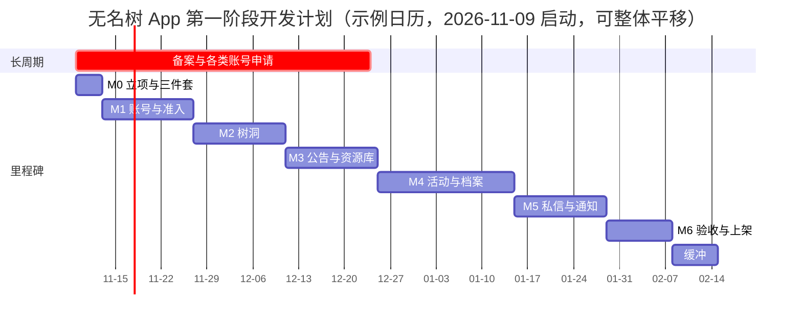

# 无名树 App · 项目开发计划

| 项目 | 内容 |
|---|---|
| 版本 | V1.0 |
| 日期 | 2026 年 11 月 7 日 |
| 依据 | 《技术设计文档-v1.0》第 11 章、《技术架构设计-v1.0》、《细化设计-v1.0》、`schema-init-v1.0.sql`、`openapi-v1.0.yaml` |
| 范围 | 第一阶段「可用」：一个真实邀请制小社群跑起来（对齐产品文档 11.3） |
| 状态 | 执行计划稿，随设计文档评审同步生效 |

本文把设计文档转译为可执行的任务分解。原则：**里程碑沿用技术设计 11.1（M0–M6），任务粒度到人天**，每项任务标注设计依据与验收要点；预估含联调与自测，不含评审等待。

---

## 目录

- [1 计划概要](#1-计划概要)
- [2 人力与泳道](#2-人力与泳道)
- [3 里程碑总览](#3-里程碑总览)
- [4 长周期事项（第一周全部启动）](#4-长周期事项第一周全部启动)
- [5 任务分解](#5-任务分解)
- [6 垂直切片：先钉死约定](#6-垂直切片先钉死约定)
- [7 质量门禁（每里程碑 DoD）](#7-质量门禁每里程碑-dod)
- [8 发版与上线节奏](#8-发版与上线节奏)
- [9 计划风险与应对](#9-计划风险与应对)
- [10 例行机制与文档同步](#10-例行机制与文档同步)

---

# 1 计划概要

| 项 | 内容 |
|---|---|
| 目标 | 邀请审核、公告、树洞、资源库、活动报名、档案、私信、设置、举报全链路上线内测 |
| 周期 | 12 周里程碑 + 1 周缓冲（约 13 周日历，含节假日弹性） |
| 人力 | 研发 2 人（A：Flutter 客户端；B：Go 服务端 + 管理台）；产品/设计走查支持；运营/管理员兼职内容准备 |
| 工作量 | 约 111 人天（含联调自测），与「10–12 周、2 人并行」的既有估算一致 |
| 启动 | 示例日历按 2026-11-09（周一）W1 起，可整体平移 |
| 发版 | W7 起 Android 内测包经 apkserver 周更；W12 TestFlight 提审；公测上架待备案完成 |
| 基线约束 | 架构决策只写进架构文档；契约变更先改 YAML 评审；每里程碑走红线回归（技术设计 2.4） |

# 2 人力与泳道

| 角色 | 职责 | 主要任务段 |
|---|---|---|
| 研发 A（客户端） | Flutter 全部页面与设计系统、客户端测试 | M0.3 起，贯穿 |
| 研发 B（服务端） | Go API、管理台、迁移、部署三件套、压测 | M0.2 起，贯穿 |
| 产品/设计 | 原型为 UI 验收锚点；文案终稿；走查 | 每里程碑验收日 |
| 运营/管理员（兼职） | 内容素材、SOP、内测组织 | 见下表 |

**内容与运营泳道**（不占研发排期，但为验收前置条件）：

| 周次 | 交付 | 供哪条任务验收 |
|---|---|---|
| W2–W3 | 资源库 5 文件夹真实素材（对齐示例份数）、3 条公告真实文案 | M3 |
| W4 | 危机词库初版 + 求助卡热线文案（专业机构口径需产品确认） | M2 危机卡 |
| W5–W7 | 5 场活动样例数据、档案照片样例（脱敏或插画替代）、老师手记范文 | M4 |
| W9–W11 | 管理员值班流程、举报处理 SOP、审核原因模板 | M5 / M6 |
| W12+ | 内测家庭名单、邀请码发放计划（单次有效、带有效期） | M6 灰度 |

# 3 里程碑总览

| 里程碑 | 周次 | 周期 | 核心交付 | 验收锚点 |
|---|---|---|---|---|
| M0 立项与三件套 | W1（3 天） | 0.5 周 | monorepo 骨架、部署三件套、CI、长周期事项启动、设计系统 token | 服务器跑通 install→update→health |
| M1 账号与准入 | W1–W3 | 2 周 | 短信登录、邀请码、申请审核、管理台最小版、App 壳与路由守卫、垂直切片 | 「邀请码→申请→审核→登录→首页」全链路 |
| M2 树洞 | W4–W5 | 2 周 | 发帖（匿名）、楼层、回应、举报、机审钩子、危机卡、我的树洞 | 匿名 DTO 断言 + 危机词演练 |
| M3 公告与资源库 | W6–W7 | 2 周 | 公告与已读、文件存储与鉴权代理、文件夹锁定、文件预览、内测包周更 | 公告无评论接口断言；锁定不泄露 |
| M4 活动与档案 | W8–W10 | 3 周 | 活动管理、报名占位与取消、讨论区、档案上传与 audience 过滤、只读任务 | k6 不超卖；照片过滤用例全绿 |
| M5 私信与通知 | W11–W12 | 2 周 | 私信（角色约束）、推送、免打扰、通知矩阵、管理台成员与审计 | 家长间私信被拒；免打扰窗口用例 |
| M6 验收与上架 | W13+缓冲 | 1.5 周 | 红线全量回归、8 条演示路径、性能、上架材料、灰度 | 红线清单全过；内测家庭完成闭环 |

# 4 长周期事项（第一周全部启动）

外部依赖周期不可控，**未就绪不得阻塞对应里程碑以外的开发**（均有 mock 降级）：

| 事项 | 启动 | 预计周期 | 影响 | 未就绪的降级 |
|---|---|---|---|---|
| 域名注册 + ICP 备案 | W1 | 2–4 周 | HTTPS、公测 | 内测可用 IP/HTTP，但含档案照片建议等 HTTPS |
| 工信部 App 备案 | W1 | 2–6 周 | 商店上架 | 内测分发（apkserver / TestFlight）不依赖备案 |
| 短信签名 + 模板报备 | W1 | 1–2 周 | M1 真实登录 | `SMS_TYPE=mock` 固定验证码，开发不阻塞 |
| 内容安全 API 开通 | W4 | 3–5 天 | M2 机审 | `AUDIT_MODE=mock` 关键词表 |
| 厂商推送账号（华为/小米/OPPO/vivo） | W4 | 1–4 周 | M5 推送 | 应用内红点兜底，推送后补 |
| iOS 开发者账号 | W1 | 1–7 天 | TestFlight | 无（账号审核期间做 Android） |

# 5 任务分解

负责人：A=客户端，B=服务端，共=双人。预估单位人天。每项任务的实现细节以所引设计章节为准，本表不复述。

## M0 立项与三件套（W1 前半，6 人天）

| ID | 任务 | 验收要点 | 依据 | 负责 | 人天 |
|---|---|---|---|---|---|
| M0-1 | monorepo 骨架：app/ server/ admin/、.gitignore、README 收口 | 目录与架构设计第二节一致 | 架构二 | 共 | 0.5 |
| M0-2 | server 骨架：cmd/api、config、router 装配、pkg/code(httpx 信封)、healthz | 信封铁律生效，裸 JSON lint 检查通过 | 架构 3.1/3.2 | B | 1 |
| M0-3 | app 骨架：Flutter 初始化、core/api_client(信封解包+AppError)、theme token、空壳页 | dio 解包对 16 个数字码全部有路径 | 架构 4.1/4.4 | A | 1 |
| M0-4 | 部署三件套：install.sh、systemd 沙箱单元、wumingtree.sh（含 backup/update） | 单机空壳跑通 install→update→health | 架构 5.1 | B | 1 |
| M0-5 | 云主机购买、域名、DNS、Nginx、MySQL/Redis 装机、HTTPS(certbot) | `https://` 域名可访问 healthz | 架构 5.1/5.4 | B | 0.5 |
| M0-6 | CI：GitHub Actions（go vet/test、flutter analyze/test） | 两条流水线绿 | 架构六 | 共 | 0.5 |
| M0-7 | 长周期事项全部提交（第 4 节六项） | 各项拿到受理编号 | 第 4 节 | 共 | 0.5 |
| M0-8 | agents.md 建立变更记录机制；设计文档入 main | 文档基线锁定 | 架构 7 | 共 | 0.5 |
| — | **小计** | | | | **6** |

## M1 账号与准入（W1 后半–W3，20 人天）

| ID | 任务 | 验收要点 | 依据 | 负责 | 人天 |
|---|---|---|---|---|---|
| M1-1 | 迁移：000001_init.up/down（19 表）+ 可重入检查 | 重复执行不炸；down 可清库 | DDL；架构 3.7 | B | 1 |
| M1-2 | member repo + member_secure 加解密 pkg（AES-GCM + HMAC） | 密文/摘要互验单测 | DDL；架构 3.3 | B | 1 |
| M1-3 | sms pkg（mock/remote）+ 验证码 Redis TTL + ratelimit pkg | 60s/条、5 条/天生效 | 架构 3.3/3.4 | B | 1 |
| M1-4 | auth：send-code / login / refresh（轮换 + 复用检测）+ JWT 中间件 | 复用 refresh 触发 2002 全吊销 | 架构 3.3；细化 2.7 | B | 1.5 |
| M1-5 | application：提交（邀请码事务校验、phone_hash 防重）+ mine 查询 | 无效/过期/用尽分别 3002 口径 | 细化 2.1 | B | 1 |
| M1-6 | 管理台最小版：登录 + 申请列表 + 通过/拒绝（事务建 member） | 拒绝原因模板可配 | 技设 4.4 管理 | B | 2 |
| M1-7 | /me、/me/badges、/me/summary、PATCH /me | VO 无手机号字段（红线） | 技设 4.4 | B | 1 |
| M1-8 | 客户端 gate：邀请进入页（表单校验）+ 审核状态三步进度 | 禁止返回；文案对原型 | 技设 3.4 | A | 1.5 |
| M1-9 | 客户端登录页 + AuthController + 路由三态守卫 | 未登录/待审核/成员三态重定向 | 架构 4.3 | A | 1.5 |
| M1-10 | 设计系统组件：WmtHeader/WmtCard/ThickButton/Sticker/WmtPill/WmtToast/LockedCard | 色板 token 化，禁止写死色值 | 技设 3.3 | A | 2 |
| M1-11 | 首页骨架（四入口 + 风险提示条 + 今日一句）+ 我的页（身份卡） | 风险条仅首页常驻 | 技设 3.4 | A | 2 |
| M1-12 | 设置页交互（昵称弹层 8 字、开关镜像、版本号 dart-define） | 版本号读构建信息（口径统一） | 技设 3.4/12 | A | 1 |
| M1-13 | **垂直切片联调**：邀请码→申请→mock 审核→登录→首页（见第 6 节） | 全链路约定钉死 | 第 6 节 | 共 | 1 |
| M1-14 | 集成测试：准入权限矩阵 + 幂等先于频控用例 | 红线回归「手机号」项通过 | 技设 2.4/10 | B | 1 |
| — | **小计** | | | | **20** |

## M2 树洞（W4–W5，19 人天）

| ID | 任务 | 验收要点 | 依据 | 负责 | 人天 |
|---|---|---|---|---|---|
| M2-1 | post/floor/reaction repo + 发帖 service（机审钩子、client_token 幂等先于频控、频控） | 重试撞频控前先幂等通过 | 架构 3.4；细化 6 | B | 2 |
| M2-2 | 列表/详情/楼层游标分页 + 匿名 VO + 我的树洞 | 匿名响应**物理无** authorId | 技设 4.5；细化 5.1 | B | 1.5 |
| M2-3 | 回应 toggle（唯一约束）+ 删帖级联隐藏 | 楼层随帖 5001 | 技设 2.4 | B | 1 |
| M2-4 | audit pkg：mock 关键词表 / remote 适配 + **危机词分支** | 危机词不拦截 + 高优告警事件 | 架构 3.4；细化 7 | B | 1.5 |
| M2-5 | report service/module + 管理台举报队列页 | reporter_id 不回传（红线） | 细化 2.4 | B | 1.5 |
| M2-6 | 未读标记 Redis + badges 接入 | 仅布尔字段 | 架构 3.2 | B | 0.5 |
| M2-7 | 客户端树洞列表（心情筛选、时间倒序、空态） | 筛选走服务端参数 | 技设 3.5 | A | 1 |
| M2-8 | 客户端发帖页（匿名预览、草稿 KV、发送三态） | 草稿退后台保存 | 技设 3.5 | A | 2 |
| M2-9 | 客户端帖子楼层页（楼中楼、toggle 乐观更新、楼层回应） | 深度≤2 由服务端 CHECK 兜底 | 技设 3.5 | A | 2 |
| M2-10 | 举报抽屉 + 危机求助卡组件（风险条复用） | 危机帖打开即叠加 | 细化 2.5 | A | 1 |
| M2-11 | 我的树洞页 + EmojiText（局部字体兜底 + UTF-16 输入） | emoji 连续输入不乱码 | 架构 4.6 | A | 1.5 |
| M2-12 | 集成测试：匿名 DTO 断言、幂等顺序、举报匿名 | 红线回归树洞 4 项 | 技设 2.4 | B | 1 |
| — | **小计** | | | | **19** |

## M3 公告与资源库（W6–W7，17 人天）

| ID | 任务 | 验收要点 | 依据 | 负责 | 人天 |
|---|---|---|---|---|---|
| M3-1 | notice service/module + 置顶排序 + 个人已读 | 无评论端点（红线） | 细化 2.1 | B | 1 |
| M3-2 | storage pkg：本地上传、鉴权代理端点（token + Range）、缩略图两档 | 无静态目录直挂 uploads | 架构 3.9 | B | 2 |
| M3-3 | folder/file service + 可见性守卫 + /files/{id}/url | 锁定文件夹 5002 且不泄露列表 | 细化 3 | B | 1.5 |
| M3-4 | 管理台：公告分段编辑器 + 文件夹/文件管理 | 公告编辑含来源与份数 | 技设 4.4 | B | 2 |
| M3-5 | 客户端公告列表/详情（置顶贴纸、只读）+ 已读 | 无任何互动入口 | 技设 3.4 | A | 1 |
| M3-6 | 客户端资源库页（五文件夹、锁定卡）+ 文件夹页（403 引导） | 锁定渲染引导不请求列表 | 技设 3.4/3.5 | A | 1.5 |
| M3-7 | 客户端文件预览（PDF/图片、签名 URL、失败重试） | 转发提示文案对齐 | 技设 12 | A | 1.5 |
| M3-8 | 首页四入口接真实数据 + 徽标布尔 + 资源份数汇总 | 修正原型「38 份」不一致 | 技设 12 | 共 | 1 |
| M3-9 | 集成测试 + 内测包周更链路验证（apkserver + /app/latest） | 检查更新走信封 | 架构 5.3 | 共 | 1 |
| — | **小计** | | | | **17** |

## M4 活动与档案（W8–W10，26 人天）

| ID | 任务 | 验收要点 | 依据 | 负责 | 人天 |
|---|---|---|---|---|---|
| M4-1 | activity repo/service/module + 管理台 CRUD + 状态流转 | 容量满不自动 closed | 细化 2.3 | B | 2 |
| M4-2 | 报名事务（条件 UPDATE + 生成列唯一）+ 电子票 + 幂等 | 并发不超卖 | 技设 4.5 | B | 2 |
| M4-3 | 取消报名（释放名额、通知老师、权限收回） | 不要求原因、无负面记录 | 细化 2.2 | B | 1 |
| M4-4 | 讨论区 service/module（先发后审） | 只聊本场活动 | 技设 4.4 | B | 1 |
| M4-5 | 档案上传端点 + audience 标注（管理台/老师） | 无评分字段（红线） | 技设 4.2.2 | B | 2 |
| M4-6 | 档案查询守卫（报名关系 + audience 过滤 + 404）+ 只读任务 | 未报名 5001；audience 过滤 | 架构 3.5 | B | 2 |
| M4-7 | 定时任务框架（Ticker + SETNX 锁）+ 巡检任务接入 | 幂等可重跑 | 架构 3.8；细化 8 | B | 1.5 |
| M4-8 | k6 并发压测 + 调优 | 200 并发抢 3 名额成功数=3 | 技设 10.1 | B | 1 |
| M4-9 | 集成测试：多孩子多家庭照片过滤、取消流转 | audience 用例全绿 | 技设 10.2 | B | 1.5 |
| M4-10 | 客户端活动列表（类型筛选、三态名额按钮） | 按钮状态推导对齐 | 细化 2.3 | A | 1 |
| M4-11 | 客户端活动详情三 Tab（信息格、会做什么/带什么、讨论区） | 未报名时档案 Tab 不渲染 | 技设 3.4/12 | A | 2 |
| M4-12 | 客户端报名表单（两条同意版本化 + client_token）+ 报名成功电子票 | 同意缺失 4204 定位勾选项 | 细化 5.3 | A | 2 |
| M4-13 | 客户端我的报名 + 取消确认弹层 | 深链/页面双入口 | 技设 12 | A | 1 |
| M4-14 | 客户端档案三内容（相册网格、作品、手记卡）+ 深链接兜底页 | 兜底页含「去看活动」 | 技设 3.2 | A | 2 |
| M4-15 | 客户端照片查看器（预览非原图、水印、截屏提示、无保存/分享） | 不出现原图端点 | 架构 3.9 | A | 1.5 |
| — | **小计** | | | | **26** |

## M5 私信与通知（W11–W12，15 人天）

| ID | 任务 | 验收要点 | 依据 | 负责 | 人天 |
|---|---|---|---|---|---|
| M5-1 | message service/module（角色约束 + 每日巡检）+ 会话/消息/已读 | 家长间发送 5002 | 技设 4.2.2 | B | 2 |
| M5-2 | push pkg 接入（厂商通道）+ 通知矩阵事件埋点 | 隐私同意后初始化 | 细化 7/架构 7.3 | B | 2 |
| M5-3 | 免打扰延迟投递（CST 窗口、同类合并、豁免类） | 22:00–08:00 用例（固定时间构造） | 细化 9 | B | 1.5 |
| M5-4 | 活动前一天提醒 + 审核结果私信 | 豁免类不受窗口限制 | 细化 7.1 | B | 1 |
| M5-5 | 管理台：成员列表 + 手机号查看（phone.view 审计）+ 数据指标雏形 | 每次查看留痕 | 技设 5.4 | B | 1.5 |
| M5-6 | 客户端私信列表/详情（气泡、快捷回复、免打扰提示） | 品牌落款与提示文案对齐 | 技设 3.4 | A | 1.5 |
| M5-7 | 客户端推送接入 + 红点联动 + 推送总开关 | 无未读数字贯穿 | 架构 7.2 | A | 1.5 |
| M5-8 | 我的模块收尾（我的作品聚合、已加入天数）+ 通知开关页 | 三个统计口径写注释 | 架构 3.6 | A | 1 |
| M5-9 | 集成测试：通知矩阵逐项 + 免打扰窗口 | 红线回归私信/红点项 | 细化 7.1 | B | 0.5 |
| — | **小计** | | | | **15** |

## M6 验收与上架（W13 + 缓冲，8 人天）

| ID | 任务 | 验收要点 | 依据 | 负责 | 人天 |
|---|---|---|---|---|---|
| M6-1 | 红线全量回归（技术设计 2.4 清单逐条勾验） | 任一失败阻断发布 | 技设 2.4/10.3 | 共 | 1 |
| M6-2 | 8 条演示路径 E2E 走查（对照原型验收） | 无空白页/破版/横向滚动 | 技设 10.1 | 共 | 1 |
| M6-3 | 性能收口：首页聚合接口、首屏 2s、接口 P95 | 目标值全过 | 技设 8.1 | B | 1 |
| M6-4 | 上架材料：隐私政策、权限说明、备案号、商店素材 | UGC 三要素备注 | 架构 5.3 | 共 | 1 |
| M6-5 | Android 分发收口 + iOS TestFlight 提审 | 内测码发放即用 | 架构 5.3 | A | 1 |
| M6-6 | 灰度：内测家庭小范围 + 反馈收集（7 日首次发声率口径） | 指标口径按支持质量 | 技设 10.5 | 共 | 2 |
| M6-7 | 文档收口：agents.md 大版本更新、产品文档 11.4 回写 | 不一致项逐条销账 | 技设 12 | 共 | 1 |
| — | **小计** | | | | **8** |

**总计：111 人天**（M0 6 + M1 20 + M2 19 + M3 17 + M4 26 + M5 15 + M6 8）。

# 6 垂直切片：先钉死约定

W2 前半（M1 内），双人不分端合做一条贯穿切片：**提交申请 → 模拟审核 → 登录 → 首页拉取徽标**。目的（沿用参考架构第八节经验）：把以下工程约定在第一条链路上钉死，后续模块横向复制，避免返工：

1. 统一信封与数字错误码（`httpx` 全覆盖，无裸 JSON）；
2. 哨兵错误 → code 映射集中在 `pkg/code`；
3. 游标分页参数与返回结构；
4. `client_token` 幂等 + 幂等先于频控；
5. 客户端 `AppError` 展示路径与「失败保留旧值」弱网策略；
6. 迁移可重入 + install→update 发版链路；
7. 路由三态守卫 + `refreshListenable`。

切片走通前不批量铺页面（宁可 M1 后半紧）。

# 7 质量门禁（每里程碑 DoD）

每个里程碑结束时逐项勾验，全过才进入下一个：

| # | 门禁项 | 说明 |
|---|---|---|
| 1 | CI 绿 | go vet/test、flutter analyze/test 零告警 |
| 2 | 红线子集回归 | 该里程碑涉及的技术设计 2.4 条目全部通过 |
| 3 | 权限矩阵子集 | 该里程碑新增权限点逐格断言（httptest） |
| 4 | 演示路径子集 | 对应原型路径在 staging 走通，UI 对照原型验收 |
| 5 | 匿名与红线 DTO 检查 | 新增接口过一遍「匿名内容 DTO / 无计数 / 无举报人回显」检查（架构附录） |
| 6 | 文档同步 | agents.md 变更记录；契约变更已先改 YAML 评审 |
| 7 | 走查 | 产品/管理员按演示路径实际操作验收 |

# 8 发版与上线节奏

| 阶段 | 时点 | 动作 |
|---|---|---|
| 开发联调 | W1 起 | staging 环境常绿，mock 短信 / mock 机审 |
| 内测开始 | W7（M3 末） | Android 内测包经 apkserver 分发真实管理员与 3–5 家庭，先验「申请审核」真实链路 |
| 内测周更 | W7–W12 | 每周五 update 发版；按管理脚本健康检查与备份验证 |
| TestFlight | W12–W13 | iOS 提审（依赖开发者账号与 UGC 三要素备注） |
| 灰度 | W13+缓冲 | 邀请制小范围真实家庭；观察 7 日首次发声率、举报处理时效 |
| 公测上架 | 备案完成后 | 商店提交（含 App 备案号）；此前一律邀请内测口径 |

# 9 计划风险与应对

| 风险 | 影响 | 应对 |
|---|---|---|
| 备案 / 签名 / 厂商账号延迟 | 上架与推送延后 | 全部 W1 启动；mock 降级不阻塞开发；内测不依赖备案 |
| 研发 B 兼管服务端与管理台，单点瓶颈 | 里程碑延期 | 管理台只做表格密集最小版；M3 起每周核对 B 队列，必要时管理台任务让渡给 A 的空档 |
| 垂直切片拖延 | 约定不牢，后期返工 | 切片未过不铺页面（第 6 节硬约束）；M1 预留 1 人天缓冲 |
| 内容泳道滞后（素材/危机词库） | 里程碑验收缺料 | 第 2 节泳道表每周核对；危机热线文案 W4 前必须产品确认 |
| 春节假期（示例日历约在缓冲周） | 灰度中断 | 缓冲周弹性吸收；或将灰度顺延至假期后首个完整周 |
| 机审误判/漏判影响内测体验 | 信任受损 | mock→remote 切换前用存量示例数据回归；拒绝级文案温和；管理员可后台恢复 |
| 需求临时膨胀 | 偏离「可用」目标 | 不在第一阶段清单的功能一律记入二期（支付、分享卡片、Web 端、家长间私信） |

# 10 例行机制与文档同步

| 机制 | 频率 | 内容 |
|---|---|---|
| 里程碑走查 | 每里程碑末 | 按 DoD 勾验 + 演示给产品/管理员 |
| 周会 | 每周五 | 进度对齐、风险表更新、下周任务确认 |
| CI 与 staging | 每次提交 | 流水线绿为合并前提；staging 常绿 |
| agents.md 更新 | 每里程碑 | 变更记录追加（架构文档规定的大版本节奏） |
| 契约变更流程 | 按需 | 先改 `openapi-v1.0.yaml` → 评审 → 两端实现（细化设计第 10 节） |
| 备份验证 | 每月 | 抽一次备份做恢复演练（技术设计 9.3） |

---

## 结语

这份计划的三个硬约束：**长周期事项 W1 全部启动**（降级方案保证不被卡）、**垂直切片先行**（约定钉死再铺量）、**红线回归按里程碑分批消化**（M6 不欠账）。里程碑范围与技术设计 11.1 完全一致，任务粒度可直接录入看板执行。
