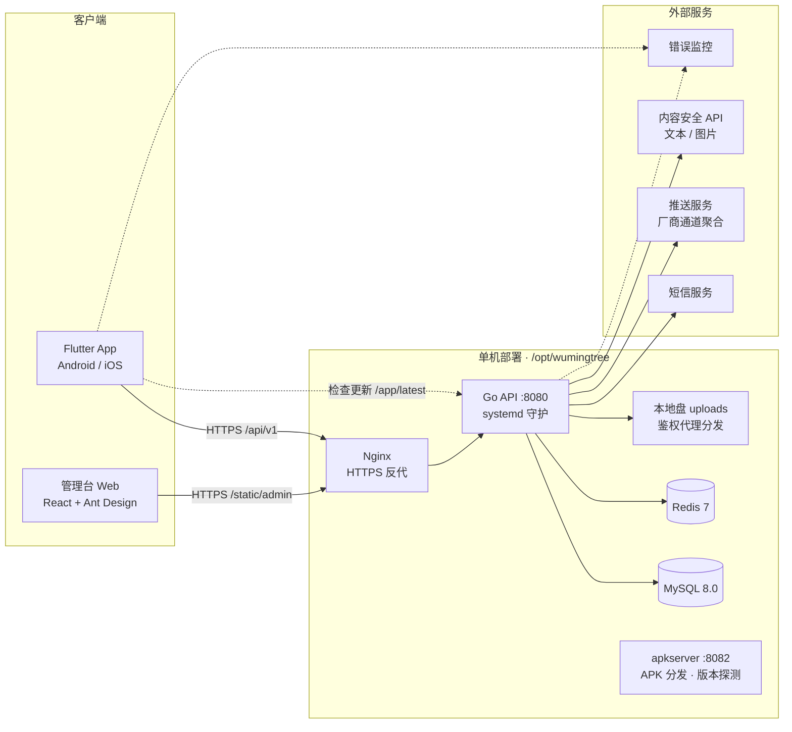

# 无名树 App · 技术架构设计

| 项目 | 内容 |
|---|---|
| 版本 | V1.0 |
| 日期 | 2026 年 11 月 7 日 |
| 架构基线 | 参照「拾光 ShinePick」v0.5.2 全栈技术架构（单机生产验证，1-3 人团队规模） |
| 依据 | 《无名树App产品说明文档-v1.0》《无名树App技术设计文档-v1.0》 |
| 状态 | 架构定稿稿，随技术设计文档一并评审 |

本文回答「工程怎么搭」。技术选型已在技术设计文档 2.2 定稿（Flutter + Go + MySQL + Redis）；本文沿用参考架构经过生产验证的**工程模式**，并按无名树的产品红线（匿名、隐私、档案权限）做适配。文中标注「沿用」的条目均为参考架构中已在线上运行、带踩坑结论的做法，不做重新发明。

---

## 目录

- [一、架构定位与明确不选](#一架构定位与明确不选)
- [二、总体架构](#二总体架构)
- [三、服务端架构（Go）](#三服务端架构go)
- [四、客户端架构（Flutter）](#四客户端架构flutter)
- [五、部署与运维](#五部署与运维)
- [六、测试策略](#六测试策略)
- [七、与既有文档的衔接](#七与既有文档的衔接)
- [八、规模扩展方向](#八规模扩展方向)
- [附录：沿用的踩坑对照](#附录沿用的踩坑对照)

---

# 一、架构定位与明确不选

无名树第一阶段是一个数百成员规模、单区域部署的邀请制社群应用，与参考架构的适用规模（DAU 数千以内单区域）一致。核心继承决策：

| 决策 | 选择 | 说明 |
|---|---|---|
| 仓库形态 | **monorepo**（沿用） | 一个仓库容纳 app / server / admin / 原型 / 文档，垂直切片一次到位 |
| 部署形态 | **单机二进制 + systemd**（沿用） | 不用 Docker：Go 交叉编译一条命令，systemd 沙箱加固，运维面最小 |
| 数据库与缓存 | **MySQL 8 + Redis 本机部署**（沿用） | install.sh 一键装机；云托管（RDS）列为触模扩展项 |
| 文件存储 | **本地盘 + API 鉴权代理分发**（沿用并强化） | 对无名树比 OSS/CDN 更合适：孩子照片不经第三方 CDN，红线更稳 |
| 状态管理 | **provider（ChangeNotifier）**（沿用） | 参考架构明确结论：小项目不建议 BLoC/Riverpod，学习成本低、够用 |
| API 约定 | **统一响应信封 + 数字错误码**（沿用） | 客户端解析器只认信封；错误码语义集中一处 |
| 数据迁移 | **手写 SQL 成对迁移**（沿用） | 不用 AutoMigrate；up/down 成对，版本表由 golang-migrate 维护 |
| 后台任务 | **Goroutine + time.Ticker**（沿用） | 不引 cron 库；任务清单见细化设计第 8 节 |
| APK 分发 | **apkserver 自建零依赖**（沿用） | 邀请制内测期不上商店，自建分发与版本探测 |

**明确不选**（含与参考架构一致的结论）：

- 微服务：单体分层（module → service → repository）足够，无名树模块边界清晰。
- GORM AutoMigrate：手写 SQL 保证可控（沿用）。
- GraphQL：REST + 统一信封足够（沿用）。
- OpenAPI 代码生成强约束：`docs/tech/openapi-v1.0.yaml` 降级为**评审与联调参考文档**，代码用服务端手写 VO + 客户端手写 model 对齐字段（沿用参考架构做法，减少工具链 ceremony）。
- Docker：Dockerfile 备而不用，触模后迁移容器化。
- Windows 桌面端：暂不做。
- Web 用户端：**已启用（2026-11-10，参考架构 5.2 同源分发模式照抄）**——Flutter 同一代码库出 Web 形态，`flutter build web --dart-define=API_BASE_URL=/api/v1 --base-href /static/web/`，产物由 Go API 同源托管 + no-cache；hash 路由免 SPA fallback。残余风险（已知并接受）：令牌存 localStorage（安全存储的 Web 实现即如此）；浏览器截屏/复制无法技术阻止（照片类内容 M4 上线时叠加轻水印）；每多一端多一个泄露面，web-dist 构建在 CI（artifact web-dist）。
- 支付：第一阶段全部免费活动，支付与退款放第二阶段（对齐产品文档 11.3）。

---

# 二、总体架构



三个服务进程 + 两个数据组件，全部在一台主机：

1. **Go API（:8080）**：唯一数据入口，同时同源托管管理台静态产物（`/static/admin`）与文件鉴权代理端点。
2. **apkserver（:8082）**：单文件 Go 服务、零依赖，提供 APK 下载（支持 Range 断点续传）与版本探测。
3. **Nginx**：HTTPS 终结与反代（内测期可先用 HTTP，见 5.4）。
4. **MySQL 8 + Redis 7**：本机部署，install.sh 安装。

**monorepo 结构**（在现有 `wumingtree-app` 仓库上扩展）：

```
wumingtree-app/
├── index.html / preview.png    # 原型保持根目录（GitHub Pages 从根目录发布，线上预览不受影响）
├── docs/                       # 产品 / 技术设计 / 架构 / 细化设计 / tech 种子文件
├── agents.md                   # 项目全景与踩坑记录（每次大版本更新）
├── app/                        # Flutter 客户端
│   ├── lib/core/               # network(api_client 信封解包) / router / theme(色板 token) / utils
│   ├── lib/features/           # gate home notice hollow library activity archive profile message
│   ├── lib/shared/             # widgets(WmtCard/ThickButton/Sticker/Pill…) / models(与 VO 一一对应)
│   └── android|ios/
├── server/
│   ├── cmd/api/main.go         # 入口：config → MySQL/Redis → 路由装配 → 后台任务
│   ├── internal/
│   │   ├── module/             # HTTP handler：绑定参数、调 service、错误映射（不含业务）
│   │   ├── service/            # 全部业务规则：校验、频控、幂等、事务、权限、跨仓库编排
│   │   ├── repository/         # GORM 查询，一个业务域一个 Repo
│   │   ├── model/              # GORM 模型
│   │   ├── middleware/         # JWT 认证（只做认证，不做授权）
│   │   ├── config/
│   │   ├── router/             # 路由装配（service 回调在此接线）
│   │   └── pkg/                # 零业务横切件：code/httpx/jwt/sms/audit/ratelimit/idempot/storage
│   ├── migrations/             # 000001_init.up.sql / .down.sql 成对（golang-migrate）
│   └── deploy/linux/           # install.sh / systemd / wumingtree.sh / env 模板 / 管理台产物
└── admin/                      # 管理台 React 源码（构建产物入 server/deploy/linux/admin/）
```

约束：原型与文档继续由 GitHub Pages 发布（根目录），工程目录加入 `.gitignore`（`server/bin/`、构建产物、`.env`）。

---

# 三、服务端架构（Go）

## 3.1 分层与依赖方向（沿用）

```
module → service → repository → model
           ↓
         pkg (code/httpx/jwt/sms/audit/ratelimit/idempot/storage)
```

- **module**：只做参数绑定、调 service、按哨兵错误映射信封 code。不含业务。
- **service**：全部业务规则——校验、频控、幂等、事务、**权限判断**、跨仓库编排。纯逻辑部分不依赖 DB，可单测。
- **repository**：GORM 查询。MemberRepo / ApplicationRepo / NoticeRepo / PostRepo / FloorRepo / ReactionRepo / FolderRepo / FileRepo / ActivityRepo / EnrollmentRepo / ArchiveRepo / MessageRepo / ReportRepo / AuditRepo。
- **pkg**：零业务横切件，全部可拷贝复用（参考架构第八节清单）。

## 3.2 统一响应信封与数字错误码（沿用，强约定）

所有接口（含 `/app/latest` 代理端点）返回：

```json
{"code": 0, "message": "ok", "data": {...}, "request_id": "uuid"}
```

HTTP 层不做业务语义区分（恒 200，网络/网关层错误除外）；业务结果看 `code`。

| code | 含义 |
|---|---|
| 0 | 成功 |
| 1001 | 参数或校验错误（message 可直接展示；`data.errors` 逐字段） |
| 2001 | 未登录 / Token 过期 |
| 2002 | Token 复用，该成员会话已全部吊销 |
| 3001 | 验证码错误或过期 |
| 3002 | 邀请码无效 / 过期 / 次数用尽 |
| 4001 | 操作过于频繁 |
| 4101 | 内容审核未通过 |
| 4201 | 名额已满 |
| 4202 | 重复报名 |
| 4203 | 手机号已有成员或未结申请 |
| 4204 | 缺少必要同意 |
| 5001 | 目标不存在或已删除（**越权、未报名访问档案统一映射到此**，不泄露存在性） |
| 5002 | 无权限（家长间私信 / 文件夹锁定 / 非作者删帖） |
| 9000 | 服务内部错误 |
| 9001 | 外部依赖不可用（机审 / 短信降级，见 3.4） |

**铁律：任何返回必须走 `httpx.OK` / `httpx.Fail` 信封，禁止裸 `c.JSON`**——客户端解析器只认信封，漏一处就是线上 bug（参考架构真实踩坑，含 API 代理端点）。

实现：service 层定义哨兵错误（`ErrValidation`→1001、`ErrNotFound`→5001、`ErrNoPerm`→5002、`ErrQuotaFull`→4201…），module 层用 `errors.Is/As` 统一映射；错误码与哨兵错误集中在 `pkg/code`。

## 3.3 鉴权与会话

- **JWT 双 token**（沿用）：access 7 天 + refresh 30 天一次性轮换（旧的立即失效）；refresh 复用检测——旧 refresh 再次使用即吊销该成员全部会话（→2002）。中间件只认 `Authorization: Bearer`。
- **手机号隔离存储**（沿用并适配红线）：`member_secure` 独立表存手机号密文与 HMAC 摘要，**member 主表不落任何敏感字段**；AES-256-GCM 加密，主密钥来自部署 env（`FILE_KEY`），KMS 信封加密列为触模扩展项。家长角色任何接口的 VO 不含手机号字段；管理台查看明文走独立端点并写审计（`phone.view`）。
- **登录**：手机号 + 验证码；审核通过即激活。验证码存 **Redis TTL 5 分钟**（不建表），发送 60s 频控；`SMS_TYPE=mock` 时固定验证码便于联调（沿用），生产切云厂商 SDK。

## 3.4 三个关键横切模式（沿用，可直接照抄）

1. **幂等**：写操作（发帖、楼层、报名、举报）携带客户端生成 `client_token`，服务端 Redis `SETNX token:TTL` 抢占，重复请求直接返回首次结果。
   **铁律：幂等检查必须放在频控之前**——否则重试请求先撞频控，永远无法幂等通过（参考架构真实踩坑）。
2. **频控**：Redis `INCR key:窗口` + 首次 `EXPIRE`。无名树限频表：短信 1 条/60s、5 条/天；申请 10 次/时/IP；发帖 10 条/天；楼层与讨论区 50 条/天；私信 200 条/天；举报 20 条/天；签名 URL 60 次/分。触发出 4001，文案不带惩罚语气。
3. **内容审核钩子**：UGC 发布前过 `audit.Auditor` 接口（`AUDIT_MODE=mock` 关键词表 / `remote` 云内容安全），拒绝级返回 4101，可疑级置 `review_status=pending` 先发后审。**无名树特有分支——危机词**：命中自伤 / 暴力 / 医疗紧急类词汇不拦截、不延迟，正常发布，同时详情页立即叠加求助卡 + 高优推送管理员（不受免打扰限制）；危机词库独立于违规词库，避免把求助误判为违规。

依赖降级（→9001 或降级策略）：文本机审不可用时走本地兜底敏感词库 + 全量进人工队列，发布不阻塞；短信不可用直接返回 9001 提示重试，不做绕过。详见细化设计第 7 节。

## 3.5 权限模型（沿用分层，适配红线）

- 认证在 middleware（只解析 JWT）；**授权在 service 层**（参考架构模式）：`internal/policy` 提供策略函数，service 调用后返回哨兵错误（`ErrNoPerm`→5002）。
- 授权三要素（技术设计文档 4.3）：成员状态 + 报名关系 + 内容归属。关键策略：
  - `ArchiveAccess`：存在该活动有效报名关系，否则 **5001**（不是 5002——不暴露档案存在性）；
  - `PhotoAudience`：`audience=all` 或 `archive_audience` 命中本人报名；
  - `FolderAccess`：成员资料文件夹按活动报名关系放行；
  - `DmAllowed`：双方至少一方为 teacher/admin，否则 5002；
  - 匿名：显示名在 service/VO 组装层解析，匿名帖与楼层 VO **物理上不含** `authorId` 字段；「我的树洞」按 author 过滤在服务端完成。
- 完整红线 → 技术强制点映射见技术设计文档 2.4，发布前逐条回归。

## 3.6 时区与日期纪律（沿用）

- 业务时区统一东八区：`cstZone = time.FixedZone("CST", 8*3600)`。所有「今天」类计算（免打扰窗口 22:00–08:00、活动前一天提醒、`readonly_at = end_at + 30 天`、申请超时 48h）只用它。
- 数据库 DATETIME(3) 统一 UTC 存储；`DATE` 类列（本阶段无，公告日期仅展示）若引入，扫描结果可能是 RFC3339 全格式，**必须 normalizeDate 取前 10 位再比较**（参考架构真实踩坑）。
- 统计口径写注释：报名数=状态为 enrolled 的行数（不含 cancelled）；回应计数=每次回应都算，不做去重口径混用。

## 3.7 数据库迁移纪律（沿用）

- 手写 SQL，**不用 AutoMigrate**：`000001_init.up.sql` + `000001_init.down.sql` 成对入库（golang-migrate 自动维护 `schema_migrations` 版本表，无需自建）；部署脚本只执行 up。
- **可重复执行不炸**：执行前检查业务表是否已有数据（member 非空则跳过建表段）——install.sh 迁移不可重入是参考架构踩过的坑（先导数据再跑 install 必炸）。
- **红线：生产库有真实数据后，一切脚本禁止 DROP/DELETE**；导出导入用 REPLACE 语义前必须三思（参考架构曾因此把数据 SQL 从仓库撤下）。
- CHECK 约束依赖 MySQL 8.0.16+；生成列 `active_key`（报名防重）等结构见 `docs/tech/schema-init-v1.0.sql`。

## 3.8 后台任务（沿用）

- Goroutine + `time.Ticker`，不引 cron 库；多任务共享单实例锁（Redis `SETNX`）防重复执行。
- 任务清单（申请超时提醒、活动 finished/readonly 巡检、复核超时提醒、未读标记对账、审计异常扫描）见细化设计第 8 节。
- **service 回调解耦**（沿用）：数据变更触发的重建（如未读标记、本周活动缓存）通过 `SetOnModified` 回调在 router 装配时接线，避免跨 service 直接依赖。

## 3.9 文件存储与分发（沿用并强化）

- 上传目录：`/opt/wumingtree/uploads/{archive,library}`，私有语义，**不落任何公开桶、不经 CDN**（相比参考架构进一步收紧——孩子照片不出现第三方链路）。
- 分发：API 鉴权代理端点（校验成员身份 + 报名关系 + 照片 audience 后 `http.ServeContent` 流式返回，支持 Range 断点续传），短时效 token 参数（15 分钟）防链接外传；`PUBLIC_BASE_URL` 抽象保留，触模后可平移到 OSS 私有桶 + 签名 URL。
- 缩略图：服务端上传后用 imaging 库生成 400px 缩略与 1080px 预览两档；原图仅在查看器按需加载，不提供下载原图端点。
- 上传链路：客户端多级压缩后 multipart 上传 API（本阶段不走直传），服务端落盘 + 生成缩略图 + 登记元数据（file_key）。

---

# 四、客户端架构（Flutter）

## 4.1 目录与分层（沿用）

- `core/`：与业务无关的地基——`network/api_client.dart`（dio 封装 + 信封解包 + AppError）、`router/app_router.dart`、`theme/app_theme.dart`（色板 / 圆角 / 厚底投影 token，与技术设计文档 3.3 一一对应）、`utils/`。
- `features/<域>/`：`xxx_page.dart`（UI）+ `xxx_controller.dart`（ChangeNotifier）。页面只 watch/read controller，**不直接碰 dio**。
- `shared/`：跨页组件（WmtCard / ThickButton / Sticker / WmtPill / RiskStrip / ImageViewer / WmtToast / LockedCard）+ `models/`（与后端 VO 一一对应的 fromJson / toJson）。

## 4.2 provider 用法约定（沿用）

- 顶层 MultiProvider 挂 3 个全局 Controller：
  - **AuthController**：成员资料与角色，驱动路由 `refreshListenable`；
  - **BadgesController**：红点布尔（轮询 + 推送到达刷新，只消费布尔字段——红线）；
  - **SettingsController**：默认匿名 / 免打扰 / 提醒开关的本地镜像（服务端为准，提交前兜底）。
- Controller 持有 `AuthController` 引用以复用其 `api`；列表数据自带「失败保留旧值」的弱网策略（沿用）。
- 局部页面状态（发帖表单、报名表单、筛选器）用页面级 controller 或 StatefulWidget，不进全局。
- 全局发帖草稿：本地 KV，每 2 秒与 App 退后台时保存（技术设计文档 3.5）。

## 4.3 路由铁律（沿用）

- **二级页面一律 `context.push()`**。`go()` 是平级替换、会清栈——「设置页点不回」的根源（参考架构踩过三次）。无名树 21 页中仅登录成功进首页、报名成功页关闭这两处允许 `go()` 重置栈。
- `refreshListenable: authController` 驱动三态重定向（未登录 → gate；待审核 → gate/pending；正式成员 → 全部），页面不手写跳转。
- 路由表集中在 `app_router.dart`；深链接 `/activities/:id/archive` 未报名时渲染兜底页（5001 兜底）。
- API 地址与版本号编译期注入：`--dart-define=API_BASE_URL`、`--dart-define=APP_VERSION`（沿用，一套代码多产物多地址）。

## 4.4 网络层（沿用）

- dio 封装统一 get/post/patch/delete/upload；`_unwrap` 解信封，`code != 0` 抛 `AppError(code, message)`；页面 catch `AppError` 展示 `e.message`。
- access 过期（2001）静默刷新重放一次；2002 清会话回登录。
- 重试：GET 幂等指数退避 2 次；POST 不自动重试，改为**重试时复用同一 client_token**（幂等保证安全）。
- 请求头带 `X-Request-Id`，与服务端信封 `request_id` 呼应，便于日志串联。

## 4.5 设计系统与原型对齐

- 全部视觉走 `app_theme.dart` token（surface/card/ink + 五色三档 + divider，与技术设计文档 3.3 色板表一致）；业务代码禁止写死色值。
- 组件进 shared，禁止页面内手搓一次性弹窗（沿用）；厚底按钮、贴纸、胶囊、风险条、锁定卡全部组件化。
- 文案集中 `l10n/strings.dart` 常量表（统一「App」口径、风险提示、危机求助卡文案）。
- 高保真原型（仓库根目录 `index.html`）是 UI 验收锚点（沿用）：先对原型实现，再谈发挥。

## 4.6 沿用的跨端经验（参考架构 4.5 节中适用于本项目的条目）

| 场景 | 结论（沿用） |
|---|---|
| 图片上传 | 客户端多级压缩（1920→1280→960→640 逐级降级）再传；上传超时 60s、失败保留原图可重试——档案照片上传直接复用 |
| emoji 渲染 | 树洞 UGC 必含 emoji：打包 Noto Color Emoji 但**只通过 EmojiText 组件局部应用**——全局 fontFamilyFallback 会让数字变全角宽体 |
| emoji 光标 | Dart 字符串是 UTF-16 码元坐标，输入框插入 emoji 用 `emoji.length` 而非 `runes.length`，混用导致连续输入乱码 |
| 时间解析 | Dart 解析带偏移 ISO 串得到 UTC 换算值，显示前必须 `toLocal()`——统一走模型层 `parseLocalTime()` |
| 特殊字符 | 文案里的 ✓ 等符号改用 `Icons.check`（部分 ROM 缺字形）；字符串里 `\$` 转义是乱码重灾区 |
| 宽屏阈值 | 如做平板适配，`width > 900` 才启用——阈值必须避开 widget 测试默认 800×600 窗口，否则 UI 测试全炸 |
| 生成分享图 | 档案照片默认不做分享；若二期开放，「离屏卡片只用本地渲染」（网络图来不及加载出白块）仍适用 |

---

# 五、部署与运维

## 5.1 服务端部署三件套（沿用，第一天就绪）

- `install.sh`：自动检测 yum / apt → 装 MySQL / Redis / Go（可选）→ 建库 → 跑迁移（可重入检查）→ 装 systemd 单元（沙箱加固：专用用户 wmt、ProtectSystem=strict、ReadWritePaths 仅 uploads）→ 装 `wumingtree.sh` 到 `/usr/local/bin`。
- `wumingtree.sh`：start / stop / restart / status / health / logs / backup / **update**。`update` 是日常发版唯一命令：git pull → 编译（优先本机 go，GOPROXY 默认 goproxy.cn；失败回退仓库内预编译产物 `deploy/linux/bin/`）→ mv 原子替换 → systemctl restart → 健康检查。
- env 全部集中在 `/opt/wumingtree/wumingtree.env`（systemd EnvironmentFile），密钥不入仓库：

| 变量 | 说明 |
|---|---|
| JWT_SECRET | `openssl rand -hex 32` |
| FILE_KEY | 手机号加密主密钥（AES-256-GCM），`openssl rand -hex 32` |
| DB_DSN / REDIS_ADDR | 本机连接串 |
| SMS_TYPE | mock（联调）/ remote（腾讯云短信 SendSms） |
| AUDIT_MODE | mock（关键词表）/ remote（腾讯云文本内容安全 TextModeration） |
| TENCENT_SECRET_ID / TENCENT_SECRET_KEY / TENCENT_REGION | 腾讯云 API 密钥与地域（remote 模式必填；Region 默认 ap-guangzhou） |
| SMS_SDK_APP_ID / SMS_SIGN_NAME / SMS_TEMPLATE_ID | 腾讯云短信应用、已备案签名与模板（SMS_TYPE=remote 必填） |
| PUBLIC_BASE_URL | 文件分发外链基地址 |
| PUSH_*** | 推送服务凭证 |

## 5.2 用户端 Web 与静态分发

- **用户端 Web**：`flutter build web`（CI 自动构建并上传 web-dist artifact）→ 产物部署到 `WEB_DIR`（env，默认 /opt/wumingtree/web），Go API 同源提供 `/static/web/`；**必须加 `Cache-Control: no-cache, must-revalidate`**——否则发版后浏览器用旧产物（沿用）；验证产物是否含新代码：不能 grep 中文（dart2js UTF-16），grep ASCII 特征串（如路由名 `/hollow`）。
- **管理台 Web**：`admin/` 构建产物入 `server/deploy/linux/admin/` 随仓库走，update 时复制，同源 `/static/admin/`，认证复用 JWT（role=admin）。
- **`/static/*` 必须加 `Cache-Control: no-cache, must-revalidate`**——否则发版后浏览器用旧产物，「看不到新功能」（沿用）；验证产物是否包含新代码：不能用 grep 中文（dart2js UTF-16 编码），要 grep ASCII 特征串（如路由名）。
- 管理台功能范围见技术设计文档 4.4 管理端点表（审核 / 公告 / 活动 / 档案上传 / 举报处理）。

## 5.3 客户端分发与检查更新（沿用，零依赖自建）

- **Android**：apkserver（单文件 Go、无依赖，:8082）提供下载页 + Range 断点续传 + 版本探测（扫目录文件名 `wumingtree-vX.Y.Z-android.apk` 取最高）；API 加 `/app/latest` 代理（3s 超时、优雅降级）供设置页「检查更新」。**发布新版 = 上传 APK 文件 + 删旧文件，其余全自动**。内测期邀请制社群直接用此链路，不依赖商店。
- **iOS**：TestFlight 内测；公测上架 App Store（UGC 三要素齐备：举报 / 审核 / 联系方式，提审备注邀请制与匿名设计）。
- **公测上架**：工信部 App 备案完成后填入商店（备案启动在 M0，周期数周）。

## 5.4 备份与安全

- `wumingtree.sh backup`：mysqldump gzip 到 `/opt/wumingtree/backups/` 保留 7 份，crontab 每日一次；uploads 目录随备份 tar 归档（档案照片是唯一真源）。
- 生产必改项清单：JWT_SECRET、FILE_KEY、DB 密码、SMS/AUDIT/PUSH 凭证（env 模板逐项列）。
- **传输安全**：域名第一天确定并备案（免改库）；含孩子照片的档案内容建议**内测期即启用 HTTPS**（Nginx + certbot），比参考架构的「公测前 HTTPS」口径更严——这是无名树红线决定的适配。
- 服务器 sudo 的 secure_path 通常不含 `/usr/local/bin`——管理脚本直接以 root 跑，别加 sudo（沿用）。

---

# 六、测试策略

| 层 | 做法（沿用为主） |
|---|---|
| 服务端 | service 层纯逻辑单测（不依赖 DB）：权限策略、名额计算、免打扰窗口、掩码、心情映射。`go test ./...` |
| 服务端集成 | httptest + testify 打真实路由与测试库（独立 schema 随建随清）；权限矩阵逐格断言 |
| 客户端 | model 解析 + 组件渲染 + 路由跳转 `flutter test`；analyze 保持零告警 |
| 并发压测 | k6 报名接口并发不超卖（200 并发抢 3 名额，成功数=3） |
| 联调 | mock 短信验证码 + curl 直接打接口；改动落在哪层就在哪层先验证再发版（沿用） |

已知测试坑（沿用）：`testWidgets` 是 fake-async（Hive 类真实 IO 会挂起，setUpAll 预开）；`flutter_test` 拦截所有 HTTP（E2E 用独立 dart 进程）；测试窗口 800×600（见 4.6）；**时间相关测试不要用 `now - 5min`**——零点前后跑会跨天挂，固定构造「今天 12:00」这类全天确定的值。

红线回归：发布前按技术设计文档 2.4 清单逐条勾验，任一失败阻断发布。

---

# 七、与既有文档的衔接

本架构定稿后，以下工件已同步修订（保持单一事实来源）：

| 工件 | 修订项 |
|---|---|
| 技术设计文档 v1.0 | 状态管理 Riverpod→provider；部署 Docker/RDS/OSS→单机 systemd + 本地盘；API 错误约定→统一信封数字码；JWT 2h→7d；手机号存储→member_secure 独立表；2.1/2.3/3.2/4.4/4.5/5.3/8.1/9.1–9.3/11.1/13.1 相应更新 |
| 细化设计 v1.0 | 第 1 节增补清单新增 3 项；第 2.7 节令牌时效；第 3 节错误码表改为数字信封码；第 5 节示例补信封说明；第 10 节种子文件用法更新 |
| schema-init-v1.0.sql | v1.1：member_secure 拆分（主表不含手机号）；删 sms_verify（验证码改 Redis TTL）；oss_key→file_key；头部注明 golang-migrate 版本表 |
| openapi-v1.0.yaml | 头部注明信封约定：schema 描述信封内 data；HTTP 状态码与数字码映射见细化设计第 3 节 |

后续一致性规则：**架构决策只写进本文**，技术设计文档与细化设计引用不复制；三者冲突时以评审结论为准并在本文第 7 节登记。

---

# 八、规模扩展方向

| 触模 | 动作 |
|---|---|
| 图片 / 静态资源变大 | 本地盘 → OSS 私有桶 + 签名 URL（`storage` 抽象已预留，换实现即可）；缩略图生成逻辑不变 |
| 单机 CPU 吃紧 | API 无状态，加第二台 + Nginx 负载均衡；MySQL 迁 RDS、Redis 拆独立实例 |
| 读多写少 | 热点列表进 Redis 的模式已具备，扩大缓存面即可 |
| 需要 Docker / K8s | Dockerfile 备而不用；单体先容器化，不拆微服务 |
| 多社群（第三阶段） | 先按社群 ID 数据隔离（tenant 字段 + repo 层过滤），不急于独立部署 |
| 合规升级 | 手机号加密升级 KMS 信封；审计日志外送；机审双供应商 |

---

# 附录：沿用的踩坑对照

以下参考架构第七节的高频坑，全部适用于本项目，开发时直接对照（完整列表见参考文档）：

| # | 坑 | 本项目对应场景 |
|---|---|---|
| 1 | `context.go()` 清栈导致子页无法返回 → 二级页一律 `push()` | 21 页路由（4.3 铁律） |
| 2 | Dart 时间偏移解析成 UTC → 模型层统一 `toLocal()` | 活动时间、档案日期展示 |
| 3 | 响应信封不一致（裸 c.JSON）→ 客户端全挂 → 全走 httpx | 含 `/app/latest`、静态端点 |
| 4 | 幂等在频控之后 → 重试永远失败 | 发帖 / 报名 / 举报 |
| 7 | UTF-16 码元 vs 字符数 → emoji 连续输入乱码 | 树洞发帖、私信输入框 |
| 9 | DATE 列扫出 RFC3339 → 比较前 normalizeDate | 未来引入日期列时 |
| 12 | install.sh 迁移不可重入 → 先检查表非空 | 部署三件套（3.7） |
| 14 | GitHub 推送间歇失败 → `-c http.curloptResolve=…` 绕 DNS | agents.md 已记录同类经验 |
| 15 | 服务器 git 仓库混入本地改动 → update 前 stash / checkout | wumingtree.sh update 流程 |

无名树特有注意事项（参考架构之外的补充）：

- 匿名帖 VO 物理不含作者字段——新增任何接口都要过一遍「匿名内容 DTO 检查」，日志打印同样不得输出匿名内容与作者关联。
- 生成列 `active_key` 依赖 status 值——任何直接 UPDATE enrollment 的脚本都要确认不破坏生成列语义。
- 照片鉴权代理是档案权限的唯一出口——新增文件类端点必须走同一 `storage` 代理，禁止出现静态目录直挂 uploads。
- 危机词分支永远不拦截、不延迟——审核钩子的任何改动不得影响该分支的即时性与高优告警。
