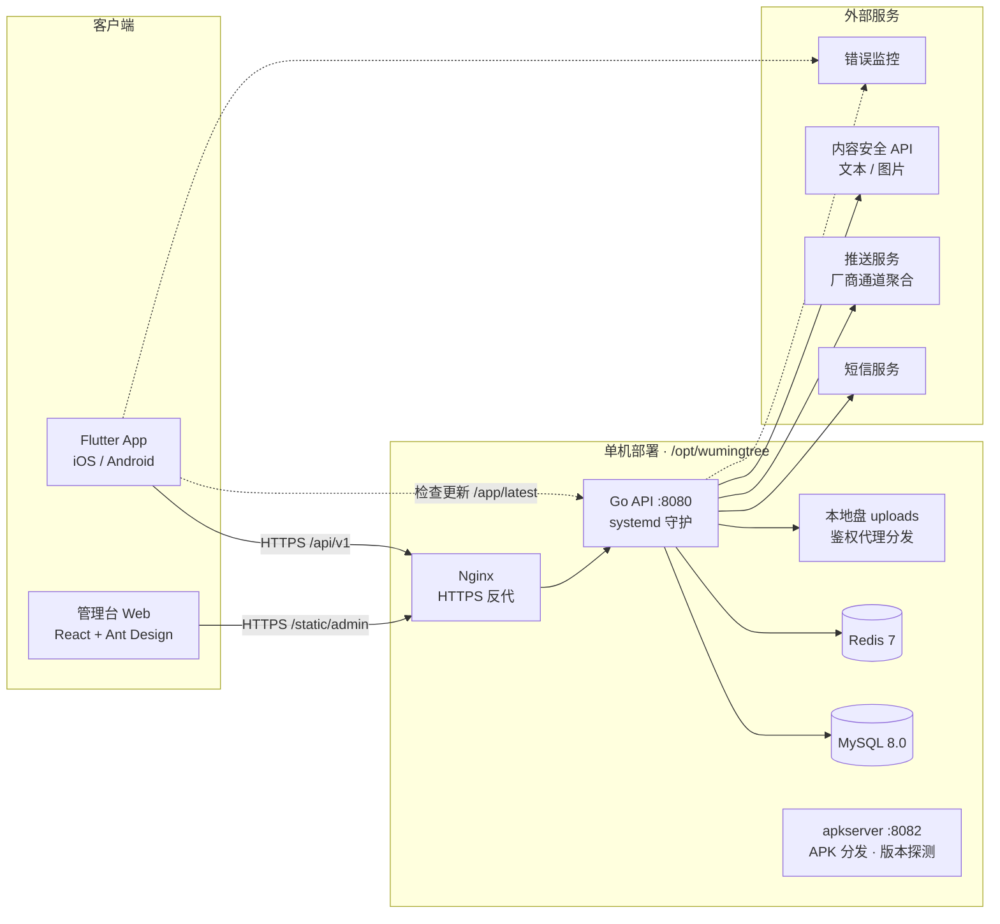
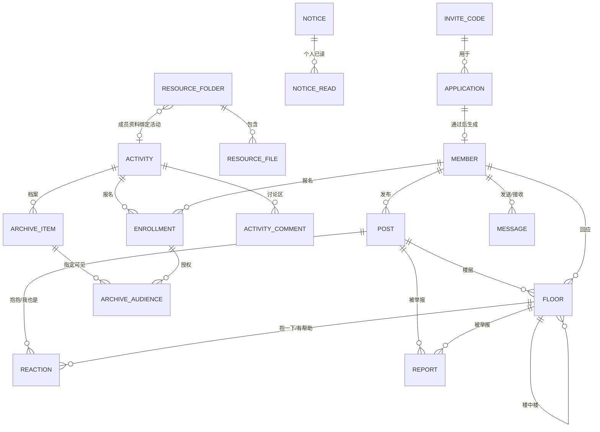
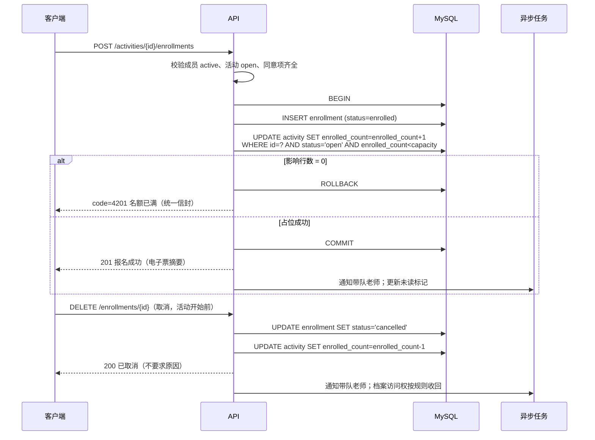
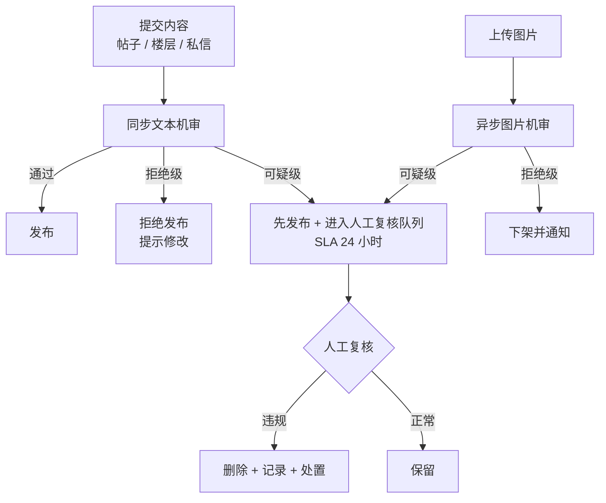

# 无名树 App · 产品技术设计文档

| 项目 | 内容 |
|---|---|
| 版本 | V1.0 |
| 日期 | 2026 年 11 月 7 日 |
| 依据 | 《无名树 App 产品说明文档》V1.0、无名树 App 明亮活泼版 v3 原型（`index.html`） |
| 技术栈 | Flutter 跨端客户端 + Go 服务端 + MySQL |
| 架构基线 | 参照《无名树App技术架构设计-v1.0》：沿用「拾光 ShinePick」生产验证的全栈工程模式 |
| 状态 | 技术共识稿，待评审 |

本文档基于产品说明文档与高保真原型整理，把产品功能、红线与边界转译为可开发、可测试、可运维的技术方案。示例数据均为虚构，不包含真实用户信息。

---

## 目录

- [1 文档说明](#1-文档说明)
- [2 总体架构](#2-总体架构)
- [3 客户端设计（Flutter）](#3-客户端设计flutter)
- [4 服务端设计](#4-服务端设计)
- [5 安全与隐私设计](#5-安全与隐私设计)
- [6 内容安全与危机干预](#6-内容安全与危机干预)
- [7 通知与消息](#7-通知与消息)
- [8 非功能设计](#8-非功能设计)
- [9 部署与运维](#9-部署与运维)
- [10 测试方案](#10-测试方案)
- [11 里程碑与任务拆解](#11-里程碑与任务拆解)
- [12 原型已知不一致的技术处理](#12-原型已知不一致的技术处理)
- [13 风险与待确认问题](#13-风险与待确认问题)

---

# 1 文档说明

## 1.1 编写目的

产品说明文档回答「做什么、不做什么」；本文回答「怎么实现、怎么守住红线、怎么分步交付」：

1. 把 21 个原型视图、13 类数据对象、权限矩阵转译为客户端工程结构、数据表、API 与权限实现。
2. 把产品红线变成可强制执行、可测试的技术约束（第 2.4 节），而不是依赖研发自觉。
3. 给出第一阶段（「可用」）的里程碑拆解，以及第二、三阶段的演进路径。

## 1.2 范围与读者

| 项目 | 说明 |
|---|---|
| 包含 | 客户端架构、服务端架构、数据模型、API、权限、安全隐私、内容安全、通知、部署运维、测试、里程碑 |
| 不包含 | UI 视觉稿与切图、详细测试用例文档、隐私政策全文、活动执行手册、报价与合同 |

| 读者 | 建议读法 |
|---|---|
| 客户端研发 | 第 2、3、7、8 章，重点 3.3–3.5 |
| 服务端研发 | 第 2、4、5、6、7 章，重点 4.2–4.5 |
| 测试 | 第 2.4（红线回归）、10 章 |
| 产品与运营 | 第 1、2、11、12、13 章，重点 2.4、11、13 |
| 运维 | 第 9 章 |

## 1.3 与产品文档的关系

- 产品文档第 8 章的 13 个数据对象是产品语言；本文第 4.2 节的 19 张表是技术落地（DDL 初稿见 `docs/tech/schema-init-v1.0.sql`），字段有增补（审计、加密、生命周期），语义保持一致。
- 产品文档第 11.4 节列出的原型不一致，本文第 12 章逐条给出技术处理，修复后需回写产品文档 11.4 节。
- 产品文档第 12 章的开放问题，凡技术相关的，本文按保守口径给出默认设计并标注「待确认」（第 13.2 节）。
- 状态机、错误码、字段校验、API 示例、限流与定时任务等工程细节，以及 DDL / OpenAPI 种子文件，见《无名树App细化设计-v1.0》（`docs/tech/` 目录）。

## 1.4 术语与约定

| 术语 | 含义 |
|---|---|
| 成员 | 通过审核的家长账号；带队老师、管理员也是成员，用角色字段区分 |
| 报名关系 | 成员与活动之间处于「已报名」状态的记录，是档案访问权的唯一来源 |
| 归属 | 内容的作者（帖、楼层）或孩子的报名（照片、作品） |
| 签名 URL | 带时效与签名的对象存储直链，过期即失效，用于文件与照片的受控分发 |
| 机审 / 人审 | 内容安全 API 的机器审核 / 管理员人工复核 |
| 时间 | 接口统一使用 ISO 8601 带时区（UTC 存储，客户端转本地展示）；免打扰窗口按北京时间 22:00–08:00 |

---

# 2 总体架构

## 2.1 系统组成



三个可执行体：

1. **Flutter App**：家长、带队老师、管理员共用的移动端（带队老师与管理员的第一阶段操作仍在管理台完成，App 内只读管理能力不开放）。
2. **管理台 Web**：管理员审核申请、发布公告、管理活动与档案、处理举报；带队老师上传活动档案。
3. **Go 服务端**：唯一数据入口，所有权限判断、加密、审计在服务端强制，客户端不做任何权限放行决定。

## 2.2 技术选型

| 层 | 选型 | 版本 | 理由 | 备选 |
|---|---|---|---|---|
| 客户端 | Flutter / Dart | 3.24+ / 3.x | 一套代码双端；自绘引擎能还原原型的手绘场景与厚底按钮等自定义视觉；性能满足中低频图文社区 | uni-app（可复用小程序生态，但视觉还原与动画能力弱）、React Native（原生组件拼装手绘风格成本高） |
| 状态管理 | provider（ChangeNotifier） | 6.x+ | 参考架构生产验证结论：小项目不建议 BLoC/Riverpod；学习成本低、全局 Controller + 页面局部状态够用 | Riverpod（编译期更安全，本团队规模下收益不抵成本） |
| 路由 | go_router | 最新稳定 | 声明式路由 + 重定向守卫，天然支持「未登录/待审核/正式成员」三态跳转与深链接兜底 | auto_route |
| 网络 | dio | 5.x | 拦截器体系成熟（令牌刷新、错误映射、重试） | http |
| 本地存储 | shared_preferences + flutter_secure_storage | — | 偏好与草稿用 KV；令牌用安全存储 | — |
| 服务端 | Go + Gin | 1.23+ | 单二进制部署运维简单、资源占用低；中间件体系承载细粒度权限；并发模型适配签名 URL、推送派发等 IO 密集任务 | NestJS（TypeScript 生态同构）、Spring Boot（对当前团队偏重） |
| ORM | GORM | v2 | 生态成熟、上手快，钩子可统一挂审计字段 | ent（类型安全更强）、sqlx（更轻量） |
| 数据库 | MySQL | 8.0 | JSON 列承载活动要点与同意记录；生成列 + 唯一索引实现「报名防重」；云数据库托管成熟 | PostgreSQL（部分索引更直接，本产品已定 MySQL 栈） |
| 缓存 | Redis | 7 | 验证码、限流、幂等、会话、未读标记 | — |
| 文件存储 | 本地盘 + API 鉴权代理分发 | — | 照片不经第三方 CDN，红线更稳；`PUBLIC_BASE_URL` 抽象保留，触模后平移 OSS 私有桶 | OSS + CDN（触模扩展项） |
| 推送 | 厂商通道聚合推送服务 | — | 国内 Android 无系统级推送，需聚合华为/小米/OPPO/vivo 通道 + APNs | 自建（成本高，不建议） |
| 短信 | 云厂商短信服务 | — | 登录验证码；签名与模板需提前备案 | — |
| 内容安全 | 云厂商内容安全 API | — | 文本 + 图片同步机审，满足 UGC 合规底线 | 网易易盾 |
| 管理台 | React + Vite + Ant Design | — | 表格密集型后台的最快路径 | — |
| 错误监控 | Sentry | — | 客户端崩溃与服务端异常聚合 | — |

选型原则：第一阶段只用成熟托管服务换交付速度；自建组件（如自建推送网关）全部推迟到第三阶段之后评估。

## 2.3 部署形态与容量预估

第一阶段（一个社群、数百成员以内），按架构设计文档 5.1 的单机模式部署：

- 1 台云主机（2C4G 起步）：Go API（systemd 守护）+ MySQL 8 + Redis 全部本机，install.sh 一键装机，不用 Docker。
- 图片与文件存本地盘（`/opt/wumingtree/uploads/`），经 API 鉴权代理分发；预估第一阶段存量 2–3GB（档案照片为主）。
- 每日 mysqldump gzip 备份保留 7 份 + uploads 归档；部署三件套（install.sh / systemd / wumingtree.sh）M0 就绪。
- 扩容路径：静态与文件迁移 OSS 私有桶 → API 加第二台 + Nginx 负载均衡 → MySQL 拆 RDS（架构设计文档第八节）。

## 2.4 产品红线的技术强制

红线不靠约定，靠实现强制 + 测试回归。每条红线对应一个技术强制点和一条发布前回归项：

| 产品红线 | 技术强制点 | 回归验证方式 |
|---|---|---|
| 不排名、不打卡、不比孩子 | 数据模型无积分/等级/签到/勋章表；帖子排序仅时间倒序，API 不提供热度排序参数 | 接口测试断言无 `sort=hot` 类参数生效；评审数据库迁移脚本无相关表 |
| 树洞默认匿名 | 作者身份只在服务端解析；匿名帖/楼层的响应 DTO 不含 `author_id` 与昵称字段，从响应结构上杜绝泄露 | 抓包断言匿名内容响应体无作者字段 |
| 删帖后回应一起消失 | 删除为软删，`post.status=removed` 时楼层接口整体不再返回 | 集成测试 |
| 红点不显示数字 | 未读接口只返回布尔字段（`has_unread`），不返回计数 | DTO 快照测试 |
| 公告板只读 | 公告实体无评论 API；路由表不注册公告评论端点 | 接口 404 断言 |
| 手机号仅管理员可见 | 手机号密文存储；家长角色 DTO 永不含手机号；管理台查看明文走独立接口并写审计日志 | 权限矩阵集成测试 + 审计日志断言 |
| 活动档案报名后才可见 | 档案查询统一走「报名关系守卫」，无其他旁路；未报名返回 404（不是 403，不暴露资源存在性） | 权限矩阵集成测试 |
| 相册只显示集体合照与本人孩子 | 照片按「集体 / 指定孩子」两级可见性建模，照片授权到报名（孩子）维度，接口按当前成员的报名记录过滤 | 集成测试：多孩子多家庭场景 |
| 老师手记不打分、不评级 | 手记表无评分字段；管理台录入表单无评分项 | 表单评审 + schema 断言 |
| 首页常驻风险提示 | 客户端常驻组件，不受接口数据控制；危机内容处理为独立分支（第 6.2 节） | Widget 测试 |
| 家长之间不私信 | 消息服务端校验「发送方或接收方至少一方为老师/管理员」，否则拒绝 | 集成测试 |
| 举报人匿名 | 举报记录的举报人字段任何接口都不回传给被举报内容相关方；仅管理台可见 | DTO 断言 |

---

# 3 客户端设计（Flutter）

## 3.1 工程结构

按功能模块组织（feature-first），`core` 放横切能力：

```
lib/
  main.dart
  app.dart                     # MaterialApp、路由表、主题
  core/
    theme/                     # 色板、字体、圆角、厚底按钮主题
      wmt_colors.dart
      wmt_typography.dart
      wmt_theme.dart
    router/                    # go_router 配置与守卫
    network/                   # dio 客户端、拦截器、错误映射
    auth/                      # 令牌存取、会话状态
    storage/                   # 偏好、草稿
    widgets/                   # 设计系统组件（3.3 节）
    util/                      # 时间、掩码、校验
  features/
    gate/                      # 邀请进入、申请、审核状态
    home/                      # 首页（今日一句、四入口、本周活动、风险提示）
    notice/                    # 公告列表、公告详情
    hollow/                    # 树洞列表、发帖、帖子与楼层、我的树洞
    library/                   # 资源库、文件夹、文件预览
    activity/                  # 活动列表、详情三 Tab、报名、报名成功、讨论区
    archive/                   # 活动档案（相册、作品、手记）、照片查看
    profile/                   # 我的、我的报名、孩子的作品、设置
    message/                   # 私信列表、对话
  l10n/                        # 文案常量（统一「App」口径，见 12 章）
```

每个 feature 内部三层：`data`（API + DTO + 仓库）、`domain`（实体与校验）、`presentation`（页面与控制器）。

## 3.2 核心技术决策

**状态管理（provider，沿用架构设计 4.2）**

- 顶层 MultiProvider 挂 3 个全局 Controller：`AuthController`（成员资料与角色，驱动路由 `refreshListenable`）、`BadgesController`（红点，轮询 + 推送到达时刷新，只消费布尔字段）、`SettingsController`（默认匿名 / 免打扰 / 提醒开关的本地镜像，服务端为准）。
- 页面态：每个 feature 一个 `xxx_controller.dart`（ChangeNotifier），页面只 watch/read controller，不直接碰 dio；列表数据自带「失败保留旧值」的弱网策略。
- 局部页面状态（表单、筛选器）用页面级 controller 或 StatefulWidget，不进全局。

**路由与守卫（go_router）**

| 会话状态 | 可达路由 | 其余访问 |
|---|---|---|
| 未登录 | `/gate`、`/gate/pending` | 重定向 `/gate` |
| 待审核 | `/gate`、`/gate/pending` | 重定向 `/gate/pending` |
| 正式成员 | 全部业务路由 | — |

- 审核状态页禁止返回；登录后清空路由栈进入 `/home`。
- 深链接兜底：`/activities/:id/archive` 未报名时渲染兜底页（说明「报名后可见」+ 去看活动），与产品文档 11.4 的「隐藏 Tab + 深链接兜底」一致。

**网络（dio）**

- 拦截器：Bearer 令牌注入；收到 2001（未登录 / Token 过期）时用刷新令牌静默续期重放一次，2002（Token 复用）清会话回登录；`_unwrap` 解统一信封，`code != 0` 抛 `AppError(code, message)`，页面展示 `e.message`。
- 重试：GET 幂等请求指数退避重试 2 次；POST 不自动重试，改为重试时**复用同一 client_token**（服务端幂等保证安全）。

**令牌与会话**

- Access Token（7 天）+ Refresh Token（30 天，一次性轮换），存 `flutter_secure_storage`；旧 refresh 复用即触发服务端全会话吊销。
- API 地址与版本号编译期注入：`--dart-define=API_BASE_URL`、`--dart-define=APP_VERSION`（沿用架构设计 4.3）。
- 退出登录：清空本地态并调用服务端吊销。

## 3.3 设计系统实现

**色板（来自产品文档 9.2）** 落地为 `ThemeExtension<WmtColors>`，禁止在业务代码里写死色值：

| 语义 | 色值 | ThemeExtension 字段 |
|---|---|---|
| 页面底 | `#FFFBF0` | `surface` |
| 卡片 | `#FFFFFF` | `card` |
| 主文字 | `#1C3428` | `ink` |
| 嫩叶绿三档 | `#12A566` / `#0B7A4A` / `#E2F8EB` | `green` / `greenDeep` / `greenSoft` |
| 太阳黄三档 | `#FFC63D` / `#E5A31A` / `#FFF3CC` | `yellow` / `yellowDeep` / `yellowSoft` |
| 珊瑚橙三档 | `#FF7A5C` / `#E85B3E` / `#FFE9E2` | `coral` / `coralDeep` / `coralSoft` |
| 天空蓝三档 | `#3AA9F0` / `#1E85C8` / `#E1F4FF` | `sky` / `skyDeep` / `skySoft` |
| 葡萄紫三档 | `#8A7BE6` / `#6E5FD0` / `#ECE8FD` | `grape` / `grapeDeep` / `grapeSoft` |
| 分隔线 | `#F2E8D3` | `divider` |

**组件映射（原型 → Flutter）**

| 原型实现 | Flutter 组件 | 要点 |
|---|---|---|
| `hd()` 页头 + 返回 | `WmtHeader` | 左上返回、标题居中、右侧 action 插槽 |
| 内容卡 | `WmtCard` | 24px 圆角、`#F2E8D3` 描边、白底 |
| 胶囊标签 `pill()` | `WmtPill` | 颜色跟随模块语义；单卡不超过 4 个 |
| 厚底按钮 `btn` | `ThickButton` | 实底 + 深色厚底投影，按下下沉 2px；绿=主操作、黄=轻松开始、珊瑚=负向/终止 |
| 贴纸 | `Sticker` | 轻微旋转 -2°，仅用于日期、置顶等短文本 |
| `art` 活动封面 / `sceneSvg` 首页场景 | `ArtCover` / `HomeScene` | 原型内联 SVG 转为资产文件（`flutter_svg` 渲染），或 CustomPainter 重绘；按 `cover_art` 字段取主题 |
| 心情胶囊 `moodChip()` | `MoodChip` | 心情枚举与颜色映射集中在 mood 常量表 |
| 风险提示条 `riskstrip` | `RiskStrip` | 仅首页常驻，不随内容滚动 |
| Toast `toast()` | `WmtToast` | 1.8s 自动消失，不承载关键决策（关键操作用结果页/弹层） |
| 弹层 `overlay()` / 底部抽屉 `sheet` | `showModalBottomSheet` / `WmtDialog` | 举报、退出等确认场景 |
| 锁定卡 | `LockedCard` | 锁图标 + 文案 + 引导按钮，用于成员资料与档案 |

**动效**：`rise` 进场上浮与 `floaty` 浮动保留，时长 200–400ms；全局监听系统「减少动态效果」设置（`MediaQuery.disableAnimations`）时全部关闭。

**文案管理**：所有用户可见文案集中到 `l10n/strings.dart` 常量表，禁止散落硬编码——这是统一「App / 小程序」口径和后续文案审查的机制保障（见第 12 章）。

## 3.4 页面与路由映射（原型 21 视图）

| 原型视图 | 路由 | 底部 Tab | 说明 |
|---|---|---|---|
| vGate 邀请进入 | `/gate` | 隐藏 | 邀请码 + 称呼 + 手机号 + 隐私说明 |
| vGateOk 审核状态 | `/gate/pending` | 隐藏 | 三步进度；禁止返回 |
| vHome 首页 | `/home` | 首页 | 四入口 + 本周活动 + 风险提示 |
| vNotice 公告列表 | `/notices` | 首页高亮 | 置顶 + 时间倒序，只读 |
| vNoticeDetail 公告详情 | `/notices/:id` | 首页高亮 | 无任何互动入口 |
| vHollow 树洞列表 | `/hollow` | 树洞 | 心情筛选；时间倒序 |
| vCompose 发帖 | `/hollow/compose` | 隐藏 | 默认匿名开关开启 |
| vPost 帖子与楼层 | `/hollow/posts/:id` | 树洞高亮 | 楼层 + 回应 + 举报 + 危机卡 |
| vLibrary 资源库 | `/library` | 首页高亮 | 五文件夹 + 锁定态 |
| vFolder 文件夹 | `/library/folders/:id` | 首页高亮 | 锁定时渲染引导页，不请求文件列表 |
| vActivities 活动列表 | `/activities` | 活动 | 类型筛选 + 名额状态 |
| vActivity 活动详情 | `/activities/:id` | 活动高亮 | 详情 / 讨论区 / 活动档案三 Tab；未报名时档案 Tab 直接不渲染 |
| vEnroll 报名 | `/activities/:id/enroll` | 隐藏 | 表单 + 两条同意 |
| vEnrollOk 报名成功 | `/activities/:id/enroll/success` | 隐藏 | 电子票 + 档案入口 |
| vMe 我的 | `/me` | 我的 | 身份卡 + 统计 + 五菜单 |
| vMySignups 我的报名 | `/me/enrollments` | 我的 | 含取消入口（12 章不一致项修复） |
| vMyPosts 我的树洞 | `/me/posts` | 我的 | 服务端按作者过滤，匿名帖可见 |
| vMyWorks 孩子的作品 | `/me/works` | 我的 | 按「我的报名」的档案作品聚合 |
| vSettings 设置 | `/me/settings` | 我的 | 版本号读构建信息（12 章口径统一） |
| vDm 私信 | `/me/dms` | 我的 | 仅老师 / 管理员 |
| vDmDetail 私信详情 | `/me/dms/:peerId` | 我的 | 气泡 + 快捷回复 |

## 3.5 关键交互实现

| 交互 | 实现 |
|---|---|
| 匿名开关 | 默认值取成员资料 `default_anon`；开关下方实时预览「匿名发布 · 显示『一位家长』/ 实名发布 · 显示昵称」；提交前再次提示不留可识别信息 |
| 红点 | 进入首页与 Tab 切换时查 `GET /me/badges`；推送到达按类型触发刷新；UI 仅渲染圆点，无数字 |
| 心情 / 类型筛选 | 服务端参数（`mood`、`type`），不本地过滤，保证分页正确 |
| 楼层回应 | 「对楼层回应」构造 `parent_floor_id`；楼中楼只允许一层（depth≤2），与原型 `lv 1/2` 一致 |
| 抱一下 / 我也是 / 有帮助 | toggle 语义：已回应再点取消；本地乐观更新 + 失败回滚 |
| 举报 | 底部抽屉四项原因；提交后 Toast「管理员会看到，发帖人不会知道是谁举报的」 |
| 档案照片查看 | 缩略图网格 → 点击加载预览图（非原图下载）；查看器叠加轻水印（成员昵称）；监听截屏事件给提示；不提供保存/分享入口 |
| 草稿 | 发帖页每 2 秒与 `didChangeAppLifecycleState=paused` 时保存草稿到本地 KV；发布成功后清除 |
| 电子票 | 报名成功页生成摘要卡（时间 / 集合 / 孩子 / 带队老师）；活动前一天依赖推送提醒 |
| 空态与失败 | 统一 `EmptyState` / `ErrorRetry` 组件；树洞空态用产品文案「还没有人说，第一句可以说给你听」 |

---

# 4 服务端设计

## 4.1 模块划分

```
server/
  cmd/api/main.go
  internal/
    auth/          # 短信验证码、登录、令牌、会话
    application/   # 加入申请、邀请码校验
    member/        # 成员资料、偏好、徽标（红点）、我的统计
    notice/        # 公告与个人已读
    hollow/        # 帖子、楼层、回应、举报
    library/       # 文件夹、文件、签名 URL
    activity/      # 活动、报名、讨论区
    archive/       # 档案条目、照片可见性
    message/       # 私信
    admin/         # 申请审核、公告、活动、档案上传、举报处理、成员管理
    policy/        # 权限策略函数（见 4.3）
    platform/      # 审计日志、内容安全客户端、推送派发、幂等与限流
  migrations/      # golang-migrate SQL 迁移
  api/openapi.yaml # API 契约（schema-first，见 4.4）
```

## 4.2 数据模型

### 4.2.1 实体关系



### 4.2.2 表设计

通用约定：主键 `id BIGINT UNSIGNED AUTO_INCREMENT`；时间列 `DATETIME(3)`，统一 UTC 存储、客户端转本地展示；字符集 `utf8mb4`；软删用 `status` 或 `deleted_at`；所有表含 `created_at`。

**member（成员）**

| 字段 | 类型 | 说明 |
|---|---|---|
| nickname | varchar(8) | 最多 8 字（产品规则） |
| role | varchar(16) | `member` / `teacher` / `admin` |
| status | varchar(16) | `active` / `disabled` |
| default_anon | boolean | 默认匿名，默认 true |
| dnd | boolean | 免打扰，默认 true |
| notify_notice / notify_hollow | boolean | 公告 / 树洞回应提醒开关，默认 true |
| joined_at | DATETIME(3) | 加入时间（「已加入天数」来源） |
| deleted_at | DATETIME(3) | 注销 |

**member_secure（手机号隔离存储，架构设计 3.3）**：`member_id`（主键兼外键）、`phone_cipher`（AES-256-GCM 密文，主密钥来自部署 env 的 FILE_KEY）、`phone_hash`（HMAC-SHA256 摘要，唯一索引；登录查找与防重复申请）、`updated_at`。member 主表不落任何敏感字段。

**invite_code（邀请码）**：`code`（唯一，随机生成，展示格式 `WMT-XXXX-XXXX`）、`status`（active/disabled/exhausted）、`valid_from`、`valid_until`、`max_uses`（默认 1）、`used_count`、`created_by`。占用校验在事务内 `UPDATE ... SET used_count=used_count+1 WHERE id=? AND status='active' AND used_count<max_uses AND now() BETWEEN valid_from AND valid_until`，影响行数为 0 即失效。

**application（加入申请）**：`invite_code_id`、`nickname`、`phone_cipher`、`phone_hash`、`status`（submitted/approved/rejected）、`reject_reason`（模板文案）、`reviewed_by`、`reviewed_at`、`member_id`（通过后生成的成员）。索引 `(status, created_at)`、`phone_hash`。防重：同 `phone_hash` 存在未结申请或 active 成员时拒绝。

**notice（公告）**：`pinned`、`title varchar(50)`、`segments JSON`（分段正文）、`published_by`、`published_at`。索引 `(pinned desc, published_at desc)`（8.0 支持降序索引）。
**notice_read（个人已读）**：`(member_id, notice_id)` 联合主键 + `read_at`。只做个人状态，不做任何聚合计数（红线）。

**post（树洞帖）**

| 字段 | 类型 | 说明 |
|---|---|---|
| author_id | fk member | 始终保留（删除权与治理）；匿名时任何 API 不回传 |
| mood | varchar(8) | `share` / `tired` / `ask` / `talk` |
| title | varchar(50) | 必填 |
| body | text | 可选 |
| is_anonymous | boolean | 默认 true |
| status | varchar(16) | `published` / `removed` |
| removed_reason | varchar(200) | 作者删除或处置原因 |
| published_at | DATETIME(3) | 排序列 |

索引：`(status, published_at desc)`、`(status, mood, published_at desc)`、`author_id`。

**floor（楼层）**：`post_id`、`parent_floor_id`（自引用，可空）、`depth` int（1 或 2，约束楼中楼仅一层）、`author_id`、`content varchar(500)`、`is_anonymous`（默认 true）、`status`。索引 `(post_id, created_at)`。删除帖子时楼层随 `post.status=removed` 整体不可见，不必逐条删除。

**reaction（回应）**：`member_id`、`target_type`（post/floor）、`target_id`、`type`（`hug` 抱抱、`me_too` 我也是、`helpful` 有帮助）、唯一约束 `(member_id, target_type, target_id, type)` 实现 toggle。校验：帖子级仅 `hug`/`me_too`，楼层级仅 `hug`/`helpful`；无任何负向类型（红线）。

**resource_folder（文件夹）**：`title`、`intro`、`visibility`（`member` 正式成员 / `activity` 仅活动成员）、`activity_id`（visibility=activity 时必填）、`sort`。
**resource_file（文件）**：`folder_id`、`title`、`file_type`（pdf/doc/xlsx/image）、`size_bytes`、`read_minutes`、`source`（管理员整理/家长共创）、`file_key`（本地盘相对路径，经 API 鉴权代理分发）、`status`（active/archived）、`updated_by`、`updated_at`。来源与更新时间是资源库可信度的一部分（产品文档 8.1）。

**activity（活动）**

| 字段 | 类型 | 说明 |
|---|---|---|
| title | varchar(40) | |
| type | varchar(8) | `outdoor` 野外生存 / `pbl` / `drama` / `culture` / `salon` |
| start_at / end_at | DATETIME(3) | |
| gather_place / gather_time | varchar | 集合信息 |
| age_range | varchar(20) | 展示用（如「7–12 岁」） |
| price_cents | int | 0 显示「免费 / 会员免费」；第一阶段不接支付 |
| capacity / enrolled_count | int | 名额与已报数；`enrolled_count` 由报名事务维护 |
| status | varchar(16) | `draft` / `open` / `closed` / `finished` |
| intro / points JSON / bring | — | 会做什么（要点列表）、带什么 |
| cover_art | varchar(8) | `leaf/sun/grape/coral/sky`，对应封面插画主题 |
| readonly_at | DATETIME(3) | 档案只读时间 = end_at + 30 天，定时任务写入 |

**enrollment（报名）**

| 字段 | 类型 | 说明 |
|---|---|---|
| activity_id / member_id | fk | |
| child_name | varchar(20) | 孩子称呼 |
| child_age | int | |
| note | varchar(200) | 「想提前告诉老师的事」 |
| consent | JSON | 两条同意各存 `{type, version, agreed_at}`：`safety`（接送与安全规则）、`photo`（照片仅内部档案不外传） |
| status | varchar(16) | `enrolled` / `cancelled` |
| cancelled_at | DATETIME(3) | |

报名防重：MySQL 无部分索引，用生成列实现——新增 STORED 生成列 `active_key`（`status='enrolled'` 时取 `CONCAT(activity_id, ':', member_id, ':', child_name)`，否则为 `NULL`），对 `active_key` 建唯一索引；MySQL 唯一索引允许多个 NULL，已取消的报名不占约束，等效于「仅 enrolled 状态防重」。一条报名对应一个孩子；多孩子报名即多行，天然支持产品文档第 12 章的开放问题扩展。

**activity_comment（讨论区）**：`activity_id`、`author_id`、`reply_to_id`、`content varchar(300)`、`status`。索引 `(activity_id, created_at)`。

**archive_item（档案条目）**

| 字段 | 类型 | 说明 |
|---|---|---|
| activity_id | fk | |
| type | varchar(8) | `photo` / `work` / `note` |
| title | varchar(60) | 照片说明 / 作品名 |
| file_key | varchar | 照片对象键（本地盘相对路径） |
| content | text | 手记正文 / 作品说明 |
| child_tag | varchar(20) | 作品归属孩子称呼（作品与「我的孩子」照片用） |
| audience | varchar(8) | `all` 集体内容 / `specific` 指定孩子 |
| teacher_name / teacher_role | varchar | 手记署名（who / role） |
| created_by | fk | 老师 / 管理员 |

无评分字段（红线）。手记正文格式约束「只记录发生了什么」由录入表单与内容规范保证。

**archive_audience（照片可见授权）**：`item_id`、`enrollment_id`，唯一 `(item_id, enrollment_id)`。「我的孩子」照片按报名（孩子）维度授权；查询时以当前成员的有效报名记录 join 过滤。

**message（私信）**：`sender_id`、`recipient_id`、`content varchar(500)`、`read_at`。索引 `(sender_id, recipient_id, created_at)`、`(recipient_id, read_at)`（未读判定）。应用层校验角色约束：发送方或接收方至少一方为 teacher/admin（红线）。

**report（举报）**：`target_type`（post/floor/message/resource_file）、`target_id`、`reason`（privacy/attack/ads/other）、`detail`、`reporter_id`（内部保留）、`status`（open/handled/dismissed）、`handled_by`、`handled_at`、`action`、`note`。索引 `(status, created_at)`。

**audit_log（审计）**：`actor_id`、`action`（如 `phone.view`、`photo.view`、`admin.approve`、`export`）、`target_type`、`target_id`、`ip`、`user_agent`、`at`。索引 `(actor_id, at)`、`(action, at)`。

**验证码（不建表）**：短信验证码存 Redis，TTL 5 分钟（`sms:code:{phone_hash}`），错误尝试计数与 60 秒 / 每日 5 条限流同在 Redis（沿用架构设计 3.3）；图形验证码兜底在风控触发后启用。

## 4.3 权限模型

**角色**：`member`（家长）、`teacher`（带队老师）、`admin`（管理员）。统一存于 `member.role`，一个成员一个角色（同一人身兼两职时建两个账号，避免复合权限）。

**授权三要素**（产品文档 8.2）：成员状态（`active`）+ 报名关系（enrollment）+ 内容归属（author/audience）。实现为 Gin 中间件 + Policy 策略函数（`internal/policy`），业务代码只声明策略名，不手写判断：

| 权限点 | 策略函数 | 逻辑 |
|---|---|---|
| 读业务内容 | `memberGuard` | `status=active` |
| 发帖 / 楼层 / 报名 | `memberGuard` | 同上 |
| 删自己的帖 | `postOwnerGuard` | `author_id=me` 或 `admin` |
| 读资源库 | `folderAccessGuard` | `visibility=member` 直接放行；`=activity` 查存在有效 enrollment |
| 读活动档案 | `archiveAccessGuard` | 存在该活动的 enrollment（status=enrolled，或 cancelled 且档案已生成时按 5.4 规则保留只读）；teacher/admin 放行 |
| 看集体照片 | `photoViewGuard` | `audience=all` |
| 看指定孩子照片 | `photoViewGuard` | `audience=specific` 且 `archive_audience.enrollment_id ∈ 我的报名` |
| 讨论区发言 | `memberGuard` | 全体成员可问，老师答复 |
| 档案上传 | `archivePublishGuard` | `teacher`（本活动带队）或 `admin` |
| 私信 | `dmGuard` | 双方至少一方 teacher/admin |
| 管理台 | `adminGuard` | `role=admin`；手机号明文另需 `phone.view` 审计动作 |

手机号是字段级权限：家长角色任何接口的 DTO 都不含手机号；报名页展示的掩码号码由服务端从当前成员资料生成（`138****1234`），客户端拿不到完整号。

## 4.4 API 设计

**通用约定**

- 前缀 `/api/v1`，JSON；鉴权 `Authorization: Bearer <access token>`。
- 分页：时间线类用游标 `cursor`（`published_at+id` 编码），管理台用 `offset/limit`。
- 统一响应信封（沿用架构设计 3.2，强约定）：所有接口返回 `{"code": 0, "message": "ok", "data": {...}, "request_id": "..."}`，业务结果看 code；服务端以 `httpx.OK / httpx.Fail` 封装，禁止裸 JSON。数字错误码表见架构设计 3.2 / 细化设计第 3 节。
- 幂等：报名、发帖、举报等写操作携带客户端生成的 `client_token`，服务端 Redis `SETNX` 去重，重复请求返回首次结果；**幂等检查先于频控执行**（铁律，架构设计 3.4）。
- 时间线接口一律时间倒序，无任何热度参数（红线）。
- 契约文档：`docs/tech/openapi-v1.0.yaml` 作为**评审与联调参考**（各端点 schema 描述统一信封内 data）；代码层面服务端手写 VO、客户端手写 model 对齐字段（沿用参考架构做法，不走代码生成），字段命名映射集中在 model 层。契约变更仍先改 YAML 评审。

**端点总表**

| 模块 | 方法与路径 | 说明 | 权限 |
|---|---|---|---|
| 准入 | POST `/auth/sms-codes` | 发送验证码（限流） | 公开 |
| 准入 | POST `/auth/login` | 手机号+验证码登录；返回会话与申请状态 | 公开 |
| 准入 | POST `/auth/refresh` | 刷新令牌 | 持有效刷新令牌 |
| 准入 | POST `/applications` | 提交加入申请（邀请码+称呼+手机号） | 公开（校验邀请码） |
| 准入 | GET `/applications/mine` | 查询本人申请与审核进度 | 申请者 |
| 我的 | GET `/me` | 本人资料 | 成员 |
| 我的 | PATCH `/me` | 昵称 / 默认匿名 / 免打扰 / 提醒开关 | 成员 |
| 我的 | GET `/me/badges` | 红点：公告 / 树洞 / 私信，仅布尔 | 成员 |
| 我的 | GET `/me/summary` | 我的页三项统计（报名数 / 树洞数 / 作品数） | 成员 |
| 公告 | GET `/notices` | 置顶 + 时间倒序 | 成员 |
| 公告 | GET `/notices/:id` | 详情 | 成员 |
| 公告 | POST `/notices/:id/read` | 个人已读 | 成员 |
| 树洞 | GET `/posts` | `mood` 筛选 + 游标分页 | 成员 |
| 树洞 | POST `/posts` | 发帖（默认匿名） | 成员 |
| 树洞 | GET `/posts/:id` | 帖子 + 首屏楼层 | 成员 |
| 树洞 | GET `/posts/:id/floors` | 楼层分页 | 成员 |
| 树洞 | POST `/posts/:id/floors` | 发楼层（可带 `parent_floor_id`） | 成员 |
| 树洞 | POST `/posts/:id/reactions` | 抱抱 / 我也是 toggle | 成员 |
| 树洞 | POST `/floors/:id/reactions` | 抱一下 / 有帮助 toggle | 成员 |
| 树洞 | DELETE `/posts/:id` | 删帖（回应一并隐藏） | 作者 / 管理员 |
| 树洞 | GET `/me/posts` | 我的树洞（含匿名帖） | 成员 |
| 举报 | POST `/reports` | 举报（目标类型 + 原因） | 成员 |
| 资源库 | GET `/folders` | 文件夹列表（含锁定态） | 成员 |
| 资源库 | GET `/folders/:id/files` | 文件列表；锁定返回 403 + 引导信息 | 成员 |
| 资源库 | GET `/files/:id/url` | 短时效签名 URL（15 分钟） | 成员 + 文件夹权限 |
| 活动 | GET `/activities` | `type` 筛选 | 成员 |
| 活动 | GET `/activities/:id` | 详情，含 `my_enrollment` 状态 | 成员 |
| 活动 | POST `/activities/:id/enrollments` | 报名（原子占位，见 4.5） | 成员 |
| 活动 | DELETE `/enrollments/:id` | 取消报名（释放名额） | 本人 |
| 活动 | GET `/me/enrollments` | 我的报名 | 成员 |
| 讨论 | GET `/activities/:id/comments` | 讨论区 | 成员 |
| 讨论 | POST `/activities/:id/comments` | 讨论区发言 | 成员 |
| 档案 | GET `/activities/:id/archive` | 档案三项内容与计数；未报名 404 | 报名成员 / 老师 / 管理员 |
| 档案 | GET `/archive-items/:id/photo-url` | 照片签名 URL（按 audience 过滤） | 报名成员 |
| 档案 | GET `/me/works` | 孩子的作品（跨活动聚合） | 成员 |
| 私信 | GET `/conversations` | 会话列表（仅老师 / 管理员联系人） | 成员 |
| 私信 | GET `/conversations/:peerId/messages` | 消息分页 | 双方 |
| 私信 | POST `/conversations/:peerId/messages` | 发送（角色约束） | 双方 |
| 私信 | POST `/conversations/:peerId/read` | 已读 | 双方 |
| 管理 | POST `/admin/notices` | 发布公告 | 管理员 |
| 管理 | GET `/admin/applications` | 申请列表（按状态） | 管理员 |
| 管理 | POST `/admin/applications/:id/approve` | 通过（激活账号 + 欢迎私信） | 管理员 |
| 管理 | POST `/admin/applications/:id/reject` | 拒绝（原因模板） | 管理员 |
| 管理 | POST `/admin/invites` | 生成邀请码 | 管理员 |
| 管理 | POST `/admin/activities` / PATCH `/admin/activities/:id` | 活动管理与状态流转 | 管理员 |
| 管理 | POST `/admin/activities/:id/archive-items` | 上传档案（照片标注集体 / 指定孩子） | 老师 / 管理员 |
| 管理 | GET `/admin/reports` / POST `/admin/reports/:id/handle` | 举报队列与处理 | 管理员 |
| 管理 | GET `/admin/members` | 成员列表；查看手机号明文走 `/admin/members/:id/phone` 并写审计 | 管理员 |

## 4.5 关键流程

### 报名占位与取消



要点：

- 名额一致性靠条件更新，不在应用层先查后改；配合 k6 并发压测验证不超卖（第 10 章）。
- 取消不扣名额、不要求原因、无负面记录（产品文档 7.4）；活动开始后不可自行取消，引导私信管理员。
- 取消后档案访问：活动未结束即收回；若档案已生成（罕见），保留只读至 `readonly_at`。

### 匿名发帖与楼层

1. 客户端提交 `mood/title/body/is_anonymous`（is_anonymous 缺省取成员 `default_anon`）。
2. 服务端同步机审（6.1）；通过后入库，`author_id` 始终写入。
3. 读接口在 DTO 组装层解析显示名：`is_anonymous ? "一位家长" : nickname`；匿名内容 DTO 不含作者字段，连 join 都不取作者表（防侧信道与日志泄露）。
4. 「我的树洞」按 `author_id=me` 服务端过滤，匿名帖也在列；删帖置 `status=removed`，楼层随帖子隐藏。
5. 治理例外：管理员在管理台可见匿名作者（仅限举报处置与违法内容处理），每次查看写审计。

### 档案解锁与只读

1. 活动结束（`status=finished`）后，管理台上传照片 / 作品 / 手记。
2. 报名成员访问 `GET /activities/:id/archive`，守卫校验报名关系；未报名 404，客户端深链接兜底页接管。
3. 照片访问返回签名 URL（15 分钟）+ 预览图规格；`audience=specific` 的照片仅授权对应报名家庭。
4. 每日定时任务：`end_at + 30 天` 写入 `readonly_at`；只读后内容仍可查看，不再提供互动与上传。

### 危机内容处理

见第 6.2 节：机审命中危机词不拦截发布，详情页立即叠加求助卡，同时高优通知管理员。

## 4.6 异步任务与事件

| 任务 | 触发 | 说明 |
|---|---|---|
| 推送派发 | 内容事件 | 统一经推送服务；先查免打扰窗口与用户开关，22:00–08:00 抑制或延迟 |
| 未读标记更新 | 回应 / 公告 / 私信 | 写 Redis 位标记，供 `GET /me/badges` |
| 档案只读 | 每日 03:00 | 写 `readonly_at` |
| 名额状态巡检 | 每小时 | `end_at` 过期置 `finished`；容量变更后校验 `enrolled_count` |
| 内容复核提醒 | 每小时 | 人工复核队列超 24h 未处理则提醒管理员（SLA 保障） |
| 审计异常告警 | 事件 | 批量照片访问 / 导出超阈值（如 100 张/小时）推送管理员 |

---

# 5 安全与隐私设计

## 5.1 身份与准入

- **登录方式（补充设计，产品文档未明确，待确认）**：审核通过后用「手机号 + 短信验证码」登录；提交申请与登录共用同一手机号。管理员审核通过即激活账号。
- **邀请码防猜**：系统生成 12 位随机码（展示 `WMT-XXXX-XXXX`），默认单次有效、带起止时间；申请接口按 IP + 号码限流（10 次/小时），连续失败触发验证码。
- **防批量注册**：同一 `phone_hash` 仅一条未结申请；同一设备指纹（阶段一用简单采集）异常申请量告警。
- **会话安全**：刷新令牌轮换 + 复用检测（旧刷新令牌再次使用即吊销整组会话）。

## 5.2 敏感数据分级

| 级别 | 数据 | 存储 | 访问 |
|---|---|---|---|
| P0 | 手机号、孩子称呼与年龄、报名备注、档案照片、老师手记 | 加密或受控存储；本地盘私有目录 + API 鉴权代理 | 字段级权限 + 审计；分发 URL 短时效 token |
| P1 | 树洞帖、楼层、私信、举报 | 库内明文（业务需要）但接口按权限暴露 | 成员 / 归属 / 管理员 |
| P2 | 公告、活动信息、昵称 | 常规 | 成员可见 |

## 5.3 手机号方案

- **隔离存储**（沿用架构设计 3.3）：手机号密文存 `member_secure` 独立表，member 主表不落任何敏感字段；AES-256-GCM 加密，主密钥来自部署 env（`FILE_KEY`），KMS 信封加密列为触模扩展项。
- **摘要索引**：`phone_hash = HMAC-SHA256(phone, 服务端盐)`，用于登录查找与防重，不可逆推。
- **可见性**：家长任何接口无手机号字段；报名页掩码由服务端生成；管理台查看明文调用独立端点，逐次写 `phone.view` 审计。
- **最小化**：仅准入与管理员联系用途，不用于营销（产品红线「不推送营销信息」写入通知矩阵白名单）。

## 5.4 访问审计

审计事件：手机号明文查看、档案照片访问（签名 URL 签发）、导出类操作、管理台全部写操作、举报处理、匿名作者查看。审计含操作者、目标、IP、时间，保留期不少于 1 年；异常模式（短时批量访问照片、批量导出）实时告警管理员。产品文档 10.5 的「隐私事件数目标为 0」以审计 + 告警为技术前提。

## 5.5 未成年人保护的技术落实

- 孩子无账号、无独立实体，仅以 `enrollment.child_name/child_age` 与 `archive_item.child_tag` 存在，最小化采集。
- 监护人授权：报名的两条同意（安全规则、照片范围）以 `consent` JSON 列记录版本与时间，构成授权链；同意文本版本化，条款变更需重新勾选。
- 照片可见性建模（`audience` + `archive_audience`）从数据结构上保证「只显示集体合照与本人孩子」。
- 不存在任何公开暴露面：无公开广场、无分享到站外的功能、照片 URL 短时效签名。

---

# 6 内容安全与危机干预

## 6.1 审核流水线



- 覆盖范围：树洞帖、楼层、讨论区、私信、资源文件名与简介；机审结果存档备查。
- 邀请制 + 人工审核降低入口风险，但 UGC 合规仍需机审兜底；「先发后审」适用于可疑级，拒绝级必须拦截。

## 6.2 危机干预

- **危机词分支**：命中自伤、暴力、医疗紧急类词汇的内容**不拦截、不延迟**，正常发布（先接住，符合产品语气与红线「优先展示专业求助提示，不等待社群回应」）。
- **客户端即时响应**：帖子详情顶部叠加求助卡：专业求助热线与「请先联系专业机构」提示，样式与风险提示条一致。
- **管理员高优告警**：危机内容实时推送管理员（不受免打扰窗口限制），建立值班响应流程（运营侧，技术提供通道与记录）。
- **词库管理**：危机词库独立于违规词库，由运营维护，避免把求助误判为违规。

## 6.3 举报处理

- 状态机：`open → handled / dismissed`；处理动作：删除内容、无处置（说明理由）。
- SLA：首次处理时长中位数目标 24 小时内（对齐产品文档 10.5 指标）；超时任务提醒。
- 举报人身份任何接口不回传被举报方（红线）；被举报内容作者不因被举报而收到任何提示，直至管理员处置。

---

# 7 通知与消息

## 7.1 通知矩阵

| 事件 | 接收人 | 渠道 | 免打扰 | 备注 |
|---|---|---|---|---|
| 新公告 | 全体成员（开了公告提醒的） | 推送 + 红点 | 受窗口约束 | 文案不带营销语气 |
| 树洞帖子有新回应 | 帖子作者（开了树洞提醒的） | 推送 + 红点 | 受窗口约束 | 文案如「有人回应了你」，不透露内容 |
| 审核通过 / 拒绝 | 申请者 | 私信（管理员）+ 推送 | 不受限 | 首个关键通知 |
| 报名成功 / 取消确认 | 报名成员 | 应用内结果页 | — | 不额外推送，页面即确认 |
| 活动前一天提醒 | 报名成员 | 推送 | 不受限 | 电子票摘要文案 |
| 新报名 / 取消 | 带队老师 | 推送 + 管理台 | 受窗口约束 | |
| 危机内容 | 管理员 | 推送（高优） | 不受限 | 6.2 |
| 人工复核超时 | 管理员 | 管理台 + 推送 | 受窗口约束 | SLA 保障 |
| 新私信 | 收件方 | 推送 + 红点 | 受窗口约束 | 家长间无私信（红线） |

## 7.2 免打扰与红点

- 免打扰窗口北京时间 22:00–08:00，**在服务端推送派发层实现**（抑制或延迟到窗口结束），不依赖客户端自控；用户可在设置关闭免打扰。
- 红点数据源 `GET /me/badges` 仅返回布尔；推送落地页打开后刷新。无未读数字贯穿全部界面（红线）。

## 7.3 推送合规

- 隐私政策同意后才初始化推送 SDK（工信部要求）；设置提供推送总开关。
- 厂商通道需要各安卓厂商开发者后台账号与审核，里程碑 M5 前完成申请（周期不可控，提前启动）。

---

# 8 非功能设计

## 8.1 性能

| 项 | 目标 / 方案 |
|---|---|
| 首屏 | 4G 下 2 秒内可见：首页聚合接口（今日一句 + 入口红点 + 本周活动一次返回）；客户端缓存上次快照先渲染再刷新（stale-while-revalidate） |
| 接口延迟 | P95 < 500ms（服务端）；列表默认页大小 20 |
| 图片 | 客户端上传前多级压缩（1920→1280→960→640 逐级降级，沿用）；服务端落盘后生成 400px 缩略与 1080px 预览两档；查看器按需加载，不提供原图下载端点；全部文件经 API 鉴权代理分发（短时效 token，支持 Range 断点续传） |
| 弱网 | GET 自动重试 + 指数退避；页面统一失败重试组件；关键操作（发布 / 报名 / 取消）有进行中、成功、失败三态 |

## 8.2 可用性

- 离线提示：网络不可达时全局横幅，恢复自动消失。
- 草稿：发帖草稿本地保存（3.5）。
- 会话静默续期，成员无感知登录过期（刷新失败才回登录页）。

## 8.3 可访问性

- 状态不只靠颜色：名额（剩余 / 已满 / 已报名）、锁定、只读均带文字（产品文档 9.5）。
- 主要点击区 ≥ 44px；表单字段有可见标签；`Semantics` 标注关键控件；支持系统字号缩放；「减少动态效果」关闭动效。

---

# 9 部署与运维

## 9.1 环境与合规

| 环境 | 用途 | 数据 |
|---|---|---|
| dev | 日常开发 | 造数脚本生成的虚构数据 |
| staging | 验收、回归 | 虚构数据，独立数据库与 OSS |
| prod | 线上 | 真实数据，备份与审计全开 |

- **备案**：域名 ICP 备案 + 移动互联网应用程序（App）备案（工信部要求，上架前完成，周期数周，需最先启动）；应用商店填写备案号。
- **上架**：App Store 对 UGC 应用要求举报机制（有）、内容审核（有）、便捷联系方式（管理台 + 私信管理员）；中国区上架需提供备案信息。安卓各商店材料类似。
- **隐私政策**：首次启动弹窗，同意后才初始化推送、采集 SDK；隐私政策与权限说明随上架材料提交。
- **部署三件套第一天就绪**（沿用架构设计 5.1）：install.sh / systemd 沙箱单元 / wumingtree.sh（start|stop|restart|status|health|logs|backup|update），避免后期补装返工。
- **传输安全**：域名第一天确定并备案（免改库）；含孩子照片的档案内容建议内测期即启用 HTTPS（Nginx + certbot），比参考架构「公测前 HTTPS」口径更严——由产品红线决定。

## 9.2 CI/CD

- 服务端：GitHub Actions — go vet / test → 手动触发发布；服务器日常发版走 `wumingtree.sh update`（git pull → 本机编译，GOPROXY=goproxy.cn，失败回退仓库内预编译产物 → mv 原子替换 → systemctl restart → 健康检查）；数据库迁移在部署前置步骤按序执行（golang-migrate up/down 成对，版本表自动维护，可重入）。
- 客户端：本地或 CI 构建 APK → 上传 apkserver 目录即生效（架构设计 5.3）；iOS 走 TestFlight；版本号语义化 `1.0.0` + build 号，`--dart-define=APP_VERSION` 注入。
- 仓库形态：**monorepo**——现有 `wumingtree-app` 仓库直接扩展 `app/`（Flutter）、`server/`（Go）、`admin/`（React），原型保持根目录（GitHub Pages 从根目录发布，线上预览不受影响）。

## 9.3 监控与备份

- Sentry：客户端崩溃与服务端异常，release + 版本聚合。
- 日志：结构化 JSON 日志收集（含 requestId 贯穿）；审计日志独立表，不与业务日志混存。
- 指标：QPS、错误率、慢查询、推送到达率、机审队列深度。
- 备份：crontab 每日 mysqldump gzip 至 `/opt/wumingtree/backups/` 保留 7 份；uploads 目录随备份归档（档案照片是唯一真源）；恢复演练一次/季度。

---

# 10 测试方案

## 10.1 分层

| 层 | 范围 | 工具 |
|---|---|---|
| 单元测试 | 策略函数（权限）、名额计算、免打扰窗口、掩码、心情映射 | Go testing + testify / flutter_test |
| API 集成测试 | 端点行为 + 权限矩阵逐格断言（6 角色 × 6 模块） | httptest + testify，测试库用独立 schema 随建随清 |
| 客户端 Widget / 集成测试 | 原型 30 个状态用例映射为自动化用例（见 10.2） | flutter_test / integration_test |
| 并发压测 | 报名接口并发不超卖、不漏卖 | k6 脚本（200 并发抢 3 个名额，断言成功数=3） |
| E2E 演示路径 | 产品文档 3.2 的 8 条路径在 staging 走通 | 人工验收 + 关键路径自动化 |

## 10.2 状态用例映射（示例）

原型 30 个状态用例按模块归并为核心用例集，全部进客户端集成测试：

| 模块 | 必测用例 |
|---|---|
| 准入 | 邀请码失效 / 重复申请 / 提交成功进审核页 / 审核通过登录进入首页 |
| 树洞 | 四种心情筛选 / 匿名与实名显示 / 楼中楼层级 / toggle 回应 / 举报四原因 / 删帖后楼层不可见 / 我的树洞含匿名帖 |
| 资源库 | 五文件夹渲染 / 成员资料锁定（不请求文件列表）/ 文件签名 URL 过期重新获取 |
| 活动 | 三种名额状态按钮 / 类型筛选 / 报名同意缺一不可 / 满员 409 / 取消后名额回升 / 电子票字段 |
| 档案 | 未报名 Tab 隐藏 / 深链接兜底 / 解锁三项内容 / 只看集体照与本人孩子 / 30 天只读 |
| 私信与设置 | 家长间私信被拒 / 免打扰窗口抑制 / 设置项即时生效 / 版本号一致 |

## 10.3 红线回归清单

发布前按第 2.4 节红线表逐条勾验；任何一条失败即阻断发布。

---

# 11 里程碑与任务拆解

## 11.1 第一阶段「可用」（目标 10–12 周，2 名研发并行）

| 里程碑 | 周期 | 范围 | 交付验收 |
|---|---|---|---|
| M0 立项 | 0.5 周 | monorepo 骨架（app/server/admin）、部署三件套（install.sh / systemd / 管理脚本）、CI、备案与短信签名申请启动、设计系统基座 | 单机空壳跑通 install→update 链路；备案进入流程 |
| M1 账号与准入 | 2 周 | 短信登录、邀请码、申请与审核流（含管理台最小版：登录、申请列表、通过/拒绝）、成员资料、App 壳与路由守卫 | 走通「邀请码 → 申请 → 审核 → 登录 → 首页」 |
| M2 树洞 | 2 周 | 发帖（匿名）、楼层、回应、举报、我的树洞、机审接入、危机卡 | 权限与匿名响应结构测试全绿 |
| M3 公告与资源库 | 2 周 | 公告发布与个人已读、文件夹 / 文件 / 签名 URL / PDF 与图片预览 | 红点布尔、公告无评论接口断言 |
| M4 活动与档案 | 3 周 | 活动管理与列表详情、报名占位与取消、讨论区、档案上传（老师）、解锁与 audience 过滤、30 天只读任务 | k6 并发压测不超卖；多孩子照片过滤用例通过 |
| M5 私信与通知 | 2 周 | 私信（角色约束）、推送接入与免打扰、设置页、我的模块收尾 | 通知矩阵逐项验证 |
| M6 验收与上架 | 1.5 周 | 红线回归、性能调优、上架材料、灰度发布 | 2.4 红线清单全过；商店提审 |

关键路径提示：备案、短信签名、各厂商推送后台账号审核周期长且不可控，M0 全部启动申请。

## 11.2 第二阶段「可控」（概要）

管理台完整化（公告编辑器、活动模板、数据看板）、支付与退款（免费 / 付费活动状态机、候补）、内容安全升级（图片先审后发可选、处置工作流）、数据权利（查看 / 更正 / 删除 / 导出自助化）、审计报表。对齐产品文档 11.3。

## 11.3 第三阶段「可复制」（概要）

多社群数据隔离（租户化）、活动模板库、带队老师工作台（App 内）、资源协作（家长共创审核流）、轻度数据分析（支持质量指标，不做成员考核）。

---

# 12 原型已知不一致的技术处理

对产品文档 11.4 与 agents.md 第 4 节的不一致项，给出技术处理；修复后需回写产品文档 11.4。

| # | 位置 | 技术处理 | 阶段 |
|---|---|---|---|
| 1 | 首页资源库「38 份资料」与示例 20 份不符 | 客户端不写死计数：`GET /folders` 汇总真实份数；或经产品确认改为「5 个主题 · 长期留存」 | 第一阶段 M3 |
| 2 | 公告出现「在小程序里取消」 | 文案集中在 `l10n` 常量表并统一为「在 App 内取消」；建文案审查清单 | 第一阶段 M3 |
| 3 | 「可以取消」无取消入口 | 按第 4.5 节补齐：我的报名卡 + 活动详情已报名态双入口、确认弹层（不要求原因）、状态机与名额释放、带队老师通知 | 第一阶段 M4 |
| 4 | 未报名显示档案锁定页 | 正式版隐藏档案 Tab（按 `my_enrollment` 渲染）；深链接路由守卫渲染兜底页 | 第一阶段 M4 |
| 5 | 版本号 v0.3 与 v3 口径混乱 | 约定：App 采用语义化版本（第一阶段 1.0.0）；原型保留「原型 v3」命名；设置页版本号读构建信息，不再手写 | 第一阶段 M1 |
| 6 | 讨论区静态回应 | `activity_comment` 表 + API + 发送三态（4.4）；原型静态数据仅保留在原型 | 第一阶段 M4 |
| 7 | 分享 / 文件打开只弹 Toast | 文件预览（PDF / 图片）第一阶段实现；「分享卡片」评估后放第二阶段（产品无公开分享诉求，且涉及照片外流边界，默认不做档案类分享） | 拆分 |
| 8 | 「模拟管理员审核通过」按钮 | 替换为管理台审核 + 结果私信通知（4.4 管理端点）；原型保留模拟按钮不动 | 第一阶段 M1 |

---

# 13 风险与待确认问题

## 13.1 技术风险

| 风险 | 影响 | 对策 |
|---|---|---|
| 报名超卖 / 漏卖 | 名额数据失信、现场冲突 | 条件更新事务 + 部分唯一索引 + k6 并发压测 |
| 机审漏判 / 误判 | 违规内容存在；正常求助被误伤 | 可疑级人工复核 SLA；危机词库独立；管理员可恢复误删 |
| 照片截屏无法完全阻止 | 「禁止保存转发」红线的技术边界 | 明示边界：水印 + 不提供原图下载 + 短时效 URL + 截屏提示 + 审计；向产品与法务说明残余风险 |
| 推送到达率不足 | 活动提醒等关键通知丢失 | 厂商通道聚合 + 应用内红点双通道；关键提醒（活动前一天）同时进应用内 |
| 短信成本与签名审核 | 登录受阻 | M0 提前申请签名模板；验证码限流控制成本 |
| 团队规模小、单点风险 | 交付与维护连续性 | monorepo + CI 全自动化 + 本文档与产品文档作为交接载体；关键操作有审计可回溯 |
| App Store UGC 审核 | 上架被拒 | 具备举报 + 审核 + 联系方式三要素；提审备注说明邀请制与匿名设计 |
| 单机故障 / 数据丢失 | 服务中断、档案丢失 | 每日备份 + install.sh 可重入重装 + 恢复演练；触模后按架构设计第八节扩展路径迁移托管服务 |

## 13.2 承接产品文档的待确认问题（技术口径已按保守值设计）

| 问题 | 本文采用的保守口径 | 待确认 |
|---|---|---|
| 审核通过后如何登录 | 手机号 + 短信验证码；审核通过即激活 | 是否需要备用登录方式（如管理员代发邀请链接） |
| 邀请码发放 | 单次有效、带有效期、系统生成 | 发放渠道、是否允许多次卡 |
| 档案保留期限 | 结束后 30 天转只读，只读后继续保留（期限可配置） | 家长能否要求删除；老师手记归属 |
| 家长间私信 | 维持关闭（服务端强制） | 是否开放及防骚扰方案 |
| 多孩子报名 | 数据模型天然支持（enrollment 按孩子建行）；客户端第一阶段按单孩子表单 | 是否需要一次报名多个孩子的表单 |
| 支付与退款 | 第一阶段全部免费活动（price_cents=0 显示免费） | 付费活动定价与退款规则 |
| 活动费用与取消扣费 | 活动开始前取消不扣名额不扣费 | 付费后的取消扣费规则 |

---

## 结语

这份技术设计的三条主线：

1. **红线即约束**：产品价值观不是文档里的口号，而是落到数据模型、权限守卫、DTO 结构与发布回归清单里的硬规则（第 2.4 节）。
2. **安全默认**：匿名在服务端解析、手机号加密加审计、档案靠报名关系授权——所有安全感由系统强制，而非界面承诺。
3. **小步可用**：第一阶段只做「一个真实小社群跑起来」所需的最小集合（第 11 章），管理后台、支付、多社群按阶段演进，避免一开始把系统做重。

下一步建议：评审通过后，从 M0 启动工程仓库与备案流程，并优先确认 13.2 节的待确认问题（尤其登录方式与邀请码发放口径，影响 M1 开发）。
